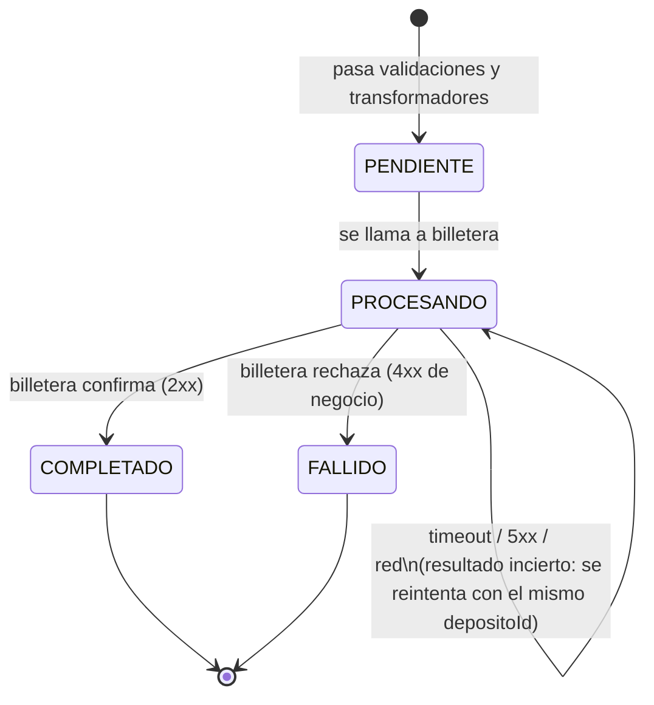

# 04 · Estados del depósito

| Campo | Valor |
|---|---|
| Versión | 0.2 |
| Columna | `depositos.estado` |
| Depende de | `03-modelo-de-datos.md`, `30-integraciones/billetera.md` |

## 1. Diagrama

## 2. Cambio respecto a v0.1 — **[DECISIÓN EQUIPO]**

En v0.1, *"error o timeout"* llevaba a `FALLIDO`. Eso es inseguro: un **timeout no significa que billetera no acreditó**, solo que la respuesta no llegó. Si se marca `FALLIDO` y el cliente reintenta, se crea otro depósito con otro `depositoId` y la idempotencia de billetera no lo detecta → **doble abono**.

Nueva regla:

| Respuesta de billetera | Qué sabemos | Estado | Respuesta al cliente |
|---|---|---|---|
| 2xx | Acreditó | `COMPLETADO` | 201 |
| 4xx de negocio (cuenta bloqueada, etc.) | No acreditó y no lo hará | `FALLIDO` | 422 `DEPOSITO_RECHAZADO` |
| Timeout, 5xx, error de red | **No sabemos** | sigue `PROCESANDO` | 502 `BILLETERA_NO_DISPONIBLE` (reintentable) |

Un depósito en `PROCESANDO` se resuelve:

1. Cuando el cliente **reintenta con la misma Idempotency-Key**: se vuelve a llamar a `acreditar` con el **mismo** `depositoId`. Billetera es idempotente por `depositoId`, así que si ya había acreditado responde OK sin acreditar de nuevo.
2. **[FASE 2]** Con un proceso de reconciliación que cada minuto toma los depósitos `PROCESANDO` con `actualizado_en` de hace más de 2 minutos y reintenta `acreditar` (máx. 5 intentos; después loguea alerta para revisión manual).

## 3. Transiciones permitidas

| Desde | Hacia | Quién | Condición |
|---|---|---|---|
| — | `PENDIENTE` | RegistrarDepositoService | Pasó validadores, transformadores y verificación final |
| `PENDIENTE` | `PROCESANDO` | RegistrarDepositoService | Justo antes de llamar a `acreditar` |
| `PROCESANDO` | `PROCESANDO` | RegistrarDepositoService (reintento) / reconciliación | Se reintenta `acreditar`; actualiza `actualizado_en` |
| `PROCESANDO` | `COMPLETADO` | RegistrarDepositoService / reconciliación | Billetera respondió 2xx |
| `PROCESANDO` | `FALLIDO` | RegistrarDepositoService / reconciliación | Billetera respondió 4xx de negocio |

- **RN-EST-01** `COMPLETADO` y `FALLIDO` son **terminales**: ninguna transición sale de ellos.
- **RN-EST-02** Toda transición se hace con `UPDATE … WHERE id = $1 AND estado = <estado_esperado>`. Si `rowCount = 0`, otro proceso cambió el estado primero: se lanza `ErrorConflicto` y se registra en log (no se sobrescribe).
- **RN-EST-03** `FALLIDO` siempre lleva `motivo_fallo` (lo exige un `CHECK`).
- **RN-EST-04** Los depósitos rechazados por validadores **no** tienen estado: nunca se guardan. Solo quedan en `auditoria_depositos`.

## 4. Criterios de aceptación

- **CA-EST-01** Dado un depósito `COMPLETADO`, cuando se intenta pasar a `FALLIDO`, entonces el repository devuelve `rowCount = 0` y el estado no cambia.
- **CA-EST-02** Dado un timeout de billetera, entonces el depósito queda `PROCESANDO` (no `FALLIDO`).
- **CA-EST-03** Dado un 4xx de negocio de billetera, entonces el depósito queda `FALLIDO` con `motivo_fallo` igual al código que devolvió billetera.
- **CA-EST-04** Dado un depósito `PROCESANDO` por timeout, cuando el cliente reintenta con la misma clave y billetera responde 200, entonces el depósito pasa a `COMPLETADO` y billetera recibió ambas llamadas con el **mismo** `depositoId`.
