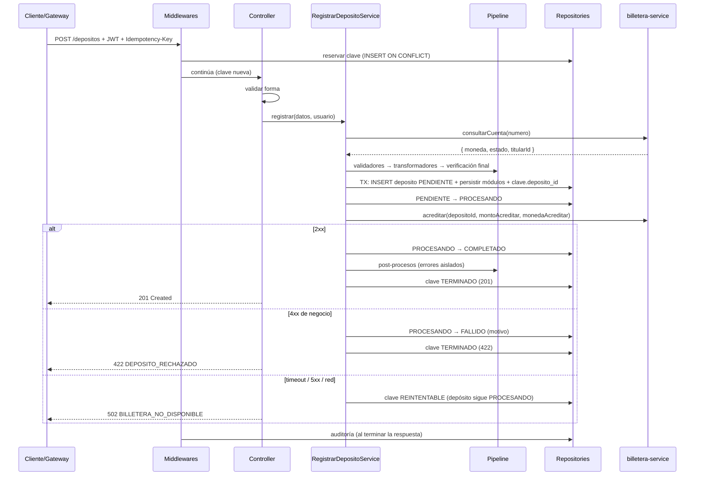

# Registrar depósito

| Campo | Valor |
|---|---|
| Versión | 0.2 |
| Tipo | Feature base (no enchufable) |
| Carpeta | `src/modules/registrar-deposito/` (routes, controller, service) |
| Depende de | `02-pipeline-y-modulos.md`, `04-estados-deposito.md`, `05-errores.md`, `10-transversales/*`, `30-integraciones/billetera.md` |

## 1. Propósito

Recibir una solicitud de depósito a una cuenta, validarla, guardarla y acreditar el monto en billetera-service, garantizando que **nunca se acredite dos veces**.

## 2. Contrato

### Petición

```http
POST /depositos
Authorization: Bearer <jwt>
Idempotency-Key: 3b9f2c1e-8d7a-4f6b-9e21-0c5d4a7b8e10
X-Correlation-Id: <opcional>
Content-Type: application/json
```

```json
{
  "cuentaDestino": "1923456789012",
  "monto": "150.50",
  "moneda": "PEN",
  "referencia": "Pago de alquiler octubre",
  "canal": "APP"
}
```

| Campo | Tipo | Oblig. | Validación de forma (400 si falla) |
|---|---|---|---|
| `cuentaDestino` | string | sí | 10–20 dígitos `^\d{10,20}$` **[POR ACORDAR]** formato con billetera |
| `monto` | string o number | sí | `^\d{1,13}(\.\d{1,2})?$` tras convertir a string; > 0 |
| `moneda` | string | sí | `PEN` o `USD` |
| `referencia` | string | no | 1–100 caracteres, sin caracteres de control; se aplica `trim` |
| `canal` | string | condicional | Ver `seguridad.md §6` (solo si el usuario tiene varios roles con canal) |

Campos desconocidos en el cuerpo → 400 `VALIDACION_FALLIDA` (evita errores silenciosos como `mount` en vez de `monto`).

Roles: `CLIENTE`, `AGENTE`, `CAJERO`.

### Respuesta 201

```http
HTTP/1.1 201 Created
Location: /depositos/0b6f4d2a-3c1e-4a8b-9f7d-2e5c6a1b0d93
X-Correlation-Id: ...
```

```json
{
  "id": "0b6f4d2a-3c1e-4a8b-9f7d-2e5c6a1b0d93",
  "cuentaDestino": "1923456789012",
  "monto": "150.50",
  "moneda": "PEN",
  "canal": "APP",
  "referencia": "Pago de alquiler octubre",
  "estado": "COMPLETADO",
  "acreditado": { "monto": "150.50", "moneda": "PEN" },
  "conversion": null,
  "creadoEn": "2026-10-13T19:49:00.000Z"
}
```

Con conversión (depósito de USD 150.00 a una cuenta en PEN, tipo de cambio compra 3.7120 → 150.00 × 3.7120 = 556.80):

```json
"monto": "150.00",
"moneda": "USD",
"acreditado": { "monto": "556.80", "moneda": "PEN" },
"conversion": { "tipoCambio": "3.7120", "operacion": "COMPRA" }
```

### Errores posibles

`VALIDACION_FALLIDA` 400 · `IDEMPOTENCY_KEY_REQUERIDA` 400 · `NO_AUTENTICADO` 401 · `PROHIBIDO` 403 · `IDEMPOTENCIA_EN_PROCESO` 409 · `IDEMPOTENCIA_CONFLICTO` 422 · `CUENTA_NO_ENCONTRADA` 422 · `CUENTA_INACTIVA` 422 · `MONEDA_NO_COINCIDE` 422 · `LIMITE_CANAL_EXCEDIDO` 422 · `DEPOSITO_RECHAZADO` 422 · `BILLETERA_NO_DISPONIBLE` 502 · `TIPO_CAMBIO_NO_DISPONIBLE` 503.

## 3. Flujo (petición nueva)



## 4. Reglas de negocio

- **RN-REG-01** El `id` del depósito lo genera el service con `crypto.randomUUID()` antes del pipeline.
- **RN-REG-02** El `canal` se determina según `seguridad.md §6`, nunca se toma del cuerpo sin verificarlo.
- **RN-REG-03** Antes del pipeline se consulta la cuenta en billetera:
  - 404 de billetera → 422 `CUENTA_NO_ENCONTRADA`.
  - `estado !== 'ACTIVA'` → 422 `CUENTA_INACTIVA`.
  - Error técnico → 502 `BILLETERA_NO_DISPONIBLE` (no se creó depósito; la clave se borra porque no hay nada que retomar).
- **RN-REG-04** Se ejecuta el pipeline (`02-pipeline-y-modulos.md`). Si un validador rechaza, la respuesta es 422 y no se guarda el depósito.
- **RN-REG-05** En **una sola transacción**: INSERT del depósito en `PENDIENTE`, `persistir` de cada transformador, y `UPDATE claves_idempotencia SET deposito_id`.
- **RN-REG-06** Pasar a `PROCESANDO` **antes** de llamar a `acreditar`, en una sentencia aparte (fuera de la transacción anterior; nunca HTTP dentro de una transacción).
- **RN-REG-07** Se acredita `montoAcreditar` en `monedaAcreditar`, con `depositoId = id` como clave de idempotencia hacia billetera.
- **RN-REG-08** Respuesta de billetera → estado y respuesta según `04-estados-deposito.md §2`.
- **RN-REG-09** Post-procesos solo si quedó `COMPLETADO`; sus errores no afectan la respuesta.
- **RN-REG-10** La respuesta final (201 o 422) se guarda en la clave de idempotencia **antes** de enviarla.
- **RN-REG-11** Reintentos (`req.idempotencia.esReintento`): ver `10-transversales/idempotencia.md §5 Reintento`. No se vuelve a ejecutar el pipeline.

## 5. Datos

| Tabla | Operación |
|---|---|
| `depositos` | INSERT, UPDATE de estado |
| `claves_idempotencia` | UPDATE (deposito_id, estado, respuesta) |
| tablas de módulos | INSERT vía `persistir` / post-procesos |

## 6. Criterios de aceptación

Usar billetera simulada (servidor fake o `nock`) y PostgreSQL real de test.

- **CA-REG-01** Depósito PEN válido a cuenta PEN activa → 201, `estado = COMPLETADO`, header `Location`, una fila en `depositos` en `COMPLETADO`, billetera recibió `acreditar` con `depositoId` igual al `id` de la respuesta.
- **CA-REG-02** Falta `cuentaDestino` → 400 `VALIDACION_FALLIDA` con `detalles[0].campo = 'cuentaDestino'`; billetera no recibió llamadas.
- **CA-REG-03** `monto: "0"` → 400.
- **CA-REG-04** `monto: "-10.00"` → 400.
- **CA-REG-05** `monto: "100.555"` → 400 (no se redondea).
- **CA-REG-06** `monto: 100.5` (number) → aceptado y guardado como `100.50`.
- **CA-REG-07** `moneda: "EUR"` → 400.
- **CA-REG-08** Campo desconocido `mount` → 400.
- **CA-REG-09** Billetera responde 404 en la consulta → 422 `CUENTA_NO_ENCONTRADA`; no hay fila en `depositos`.
- **CA-REG-10** Cuenta `BLOQUEADA` → 422 `CUENTA_INACTIVA`.
- **CA-REG-11** Billetera tarda más que `BILLETERA_TIMEOUT_ACREDITAR_MS` → 502 `BILLETERA_NO_DISPONIBLE`; depósito en `PROCESANDO`; clave `REINTENTABLE`.
- **CA-REG-12** Billetera responde 422 en `acreditar` → 422 `DEPOSITO_RECHAZADO`; depósito `FALLIDO` con `motivo_fallo`.
- **CA-REG-13** Depósito válido → existe una fila en `auditoria_depositos` con `resultado = 'OK'`.
- **CA-REG-14** Las respuestas de montos son strings con 2 decimales.
- **CA-REG-15** Tras un 201, `claves_idempotencia` tiene `estado = TERMINADO`, `status_http = 201` y `respuesta` igual al cuerpo enviado.

## 7. Fuera de alcance

- Depósitos programados o recurrentes.
- Anular/revertir un depósito completado (sería una operación nueva en billetera). **[FASE 2]**
- Depósitos a cuentas de otros bancos.

## 8. Pendientes

- **[POR ACORDAR]** Formato de `cuentaDestino` y endpoints de billetera (`30-integraciones/billetera.md`).
- **[DECISIÓN EQUIPO]** Canal derivado del rol (`seguridad.md §6`).
