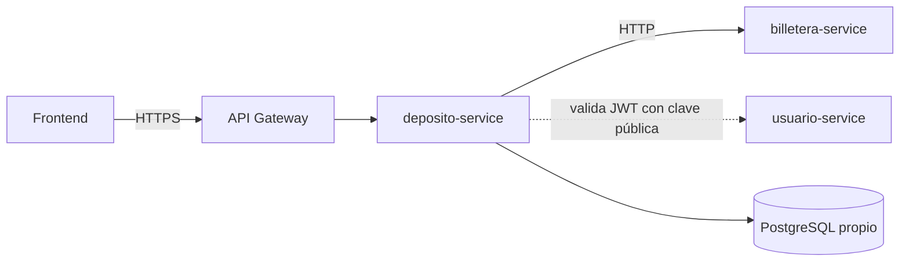

# SPEC-00 · Proyecto deposito-service

## 1. Metadatos y Tech Stack

**Objetivo:** Definir el contexto, el stack, las reglas de oro y la infraestructura base que todas las demás specs dan por hechas.

| Campo | Valor |
|---|---|
| Servicio | deposito-service, uno de los 4 microservicios de un banco (proyecto de curso) |
| Responsabilidad | Recibir, validar y registrar depósitos, y pedir a billetera-service que acredite el dinero |
| Fuera de alcance | Saldos (son de billetera-service), sagas, broker de eventos, outbox |
| Versión spec | 1.0 |

**Backend Stack:** Node.js 22 LTS, Express 4.21.2, pg 8.13.1, decimal.js 10.4.3, zod 3.23.8, jsonwebtoken 9.0.2, axios 1.7.9, js-yaml 4.1.0, pino 9.5.0. PostgreSQL 16. (Contenedor `deposito-service`).

**Pruebas:** Jest 29.7.0, Supertest 7.0.0, nock 13.5.6. Las pruebas de integración usan PostgreSQL real en Docker.

**Frontend Stack:** [POR ACORDAR].

| Microservicio | Equipo | Relación con deposito-service |
|---|---|---|
| billetera-service | Otro | Le consultamos cuentas y le pedimos acreditar (SPEC-10) |
| usuario-service | Otro | Emite el JWT que validamos (SPEC-10) |
| pagos-service | Otro | Ninguna |

## 2. Archivos Involucrados

El Agente tiene permitido leer y modificar ÚNICAMENTE los siguientes archivos:

- [NUEVO] `package.json` (Dependencias exactas de §1. Scripts: `start`, `test`, `test:unit`, `test:integration`).
- [NUEVO] `Dockerfile` (`node:22-alpine`, usuario no root, `npm ci --omit=dev`).
- [NUEVO] `docker-compose.yml` (`postgres:16`, `deposito-service`, `billetera-mock` de SPEC-10; monta `db/` en `/docker-entrypoint-initdb.d`).
- [NUEVO] `.env.example` (Todas las variables de §5, sin secretos reales).
- [NUEVO] `src/server.js` (Solo arranca `app.listen`).
- [NUEVO] `src/config.js` (Lee y valida las variables de entorno; si falta una obligatoria, el servicio no arranca).
- [NUEVO] `src/core/logger.js` (pino con `redact` de `authorization` + función `enmascararCuenta`).
- [NUEVO] `tests/helpers/db.js` (Conexión de pruebas y limpieza de tablas entre tests).

Estructura final del código (cada carpeta la crea la spec indicada):

```
src/
├── server.js · app.js · config.js
├── core/            db, cargador, pipeline, errores, logger, permisos,
│                    middlewares/, clients/, repositories/, tareas/   (SPEC-01 a 04, 10)
└── modules/<id>/    un módulo por spec 05 a 09, con el mismo id del manifest
db/                  un .sql por spec con tablas; se ejecutan en orden alfabético
mocks/billetera/     servidor simulado de billetera (SPEC-10)
tests/               unit/ · integration/ · core/ · helpers/
```

## 3. Flujo del Sistema



deposito-service nunca entra a la base de datos de otro servicio. Solo HTTP.

## 4. Reglas de Negocio (reglas de oro)

Si otra spec contradice esta sección, gana esta sección y se avisa al equipo.

| Id | Regla |
|---|---|
| PRY-R01 | Capas: `routes` → `controller` → `service` → `repository` / `client`. Ninguna capa se salta a otra. |
| PRY-R02 | Los controllers no tienen lógica de negocio: leen la petición, llaman al service y responden. |
| PRY-R03 | Los services no escriben SQL ni hacen HTTP. Solo los repositories conocen PostgreSQL y solo `src/core/clients/` conoce URLs de otros servicios. |
| PRY-R04 | Un módulo solo depende de `src/core/`. Nunca importa otro módulo. |
| PRY-R05 | Agregar o quitar una feature no modifica `src/core/`. |
| PRY-R06 | Dinero: `NUMERIC(15,2)` en BD, `Decimal` (decimal.js) en código y **string** en JSON (`"150.00"`). Nunca `Number` ni `float`. |
| PRY-R07 | Monedas permitidas: PEN y USD. Máximo 2 decimales. |
| PRY-R08 | Toda consulta SQL usa parámetros (`$1`, `$2`). Nunca concatenación. |
| PRY-R09 | Secretos y URLs solo en variables de entorno. |
| PRY-R10 | Los logs nunca contienen tokens, números de cuenta completos (usar `****-****-456789`) ni datos personales. |
| PRY-R11 | Lo marcado `[POR ACORDAR]` se implementa con un mock que respete el contrato propuesto. Nunca con valores inventados. |
| PRY-R12 | Los agentes no modifican `specs-v2/`. Si una spec es ambigua o contradictoria, se detienen y lo reportan. |

## 5. El Contrato (API Contract)

**Ruta:** `GET /health` (única ruta sin token)

**Response HTTP 200**
```json
{ "estado": "ok" }
```

**Variables de entorno** (las lee solo `src/config.js`):

| Variable | Ejemplo | Spec |
|---|---|---|
| `PORT` | `3000` | 00 |
| `DATABASE_URL` | `postgres://deposito:deposito@db:5432/deposito` | 00 |
| `LOG_LEVEL` | `info` | 00 |
| `MANIFEST_PATH` | `specs-v2/manifest.yaml` | 01 |
| `JWT_PUBLIC_KEY` · `JWT_ALGORITHMS` · `JWT_ISSUER` · `JWT_AUDIENCE` | PEM · `RS256` · `usuario-service` · `banco-api` | 02 |
| `IDEMPOTENCIA_DIAS` | `7` | 04 |
| `BILLETERA_URL` · `BILLETERA_TOKEN` · `BILLETERA_TIMEOUT_MS` | `http://billetera-mock:4000` · `dev-token` · `5000` | 10 |
| `UIF_UMBRAL_PEN` · `UIF_UMBRAL_USD` | [POR ACORDAR] | 09 |

## 6. Instrucciones de Ejecución para el Agente

1. **`desarrolladorback`:** Crear los archivos de §2. `config.js` exporta un objeto congelado. `enmascararCuenta('0011-0123-456789')` devuelve `'****-****-456789'`.
2. **`tester`:** Preparar `tests/helpers/db.js` y probar:

| Id | Caso | Esperado |
|---|---|---|
| PRY-T01 | `GET /health` sin token | 200 `{ "estado": "ok" }` |
| PRY-T02 | Arrancar sin `DATABASE_URL` | El proceso termina con un error claro |
| PRY-T03 | `enmascararCuenta('0011-0123-456789')` | `'****-****-456789'` |

3. **`revisor`:** Verificar PRY-R01 a PRY-R12 en todo cambio, de cualquier spec.

**Criterios de aceptación:**
- ✅ `docker compose up` levanta PostgreSQL, el servicio y el mock de billetera.
- ✅ `npm test` corre todas las pruebas contra la BD de Docker.
- ✅ Ningún secreto ni URL aparece en el código fuente.
