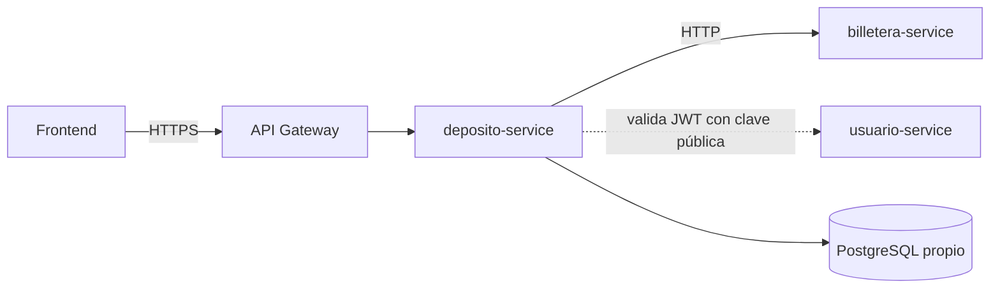

# SPEC-00 · Proyecto deposito-service

## 1. Metadatos y Tech Stack

**Objetivo:** Definir el contexto, el stack, las reglas de oro, la infraestructura y la forma de probar y revisar que todas las demás specs dan por hechas.

- **Servicio:** deposito-service, uno de los 4 microservicios de un banco (proyecto de curso).
- **Responsabilidad:** recibir, validar y registrar depósitos, y pedir a billetera-service que acredite el dinero.
- **No hace:** guardar ni modificar saldos (son de billetera-service), ni entrar a la BD de otro servicio.
- **Fuera de alcance:** sagas, broker de eventos, outbox, blockchain.
- **Otros servicios:** billetera-service (cuentas y saldos), usuario-service (emite el JWT), pagos-service (sin relación).
- **Versión spec:** 1.1

**Backend Stack:** Node.js 22 LTS, CommonJS (`require` / `module.exports`), Express 4.21.2, pg 8.13.1, decimal.js 10.4.3, zod 3.23.8, jsonwebtoken 9.0.2, axios 1.7.9, js-yaml 4.1.0, pino 9.5.0. PostgreSQL 16. Docker. (Contenedor `deposito-service`).

**Pruebas:** Jest 29.7.0, Supertest 7.0.0, nock 13.5.6. **Frontend:** [POR ACORDAR].

## 2. Archivos Involucrados

El Agente tiene permitido leer y modificar ÚNICAMENTE los siguientes archivos:

- [NUEVO] `package.json` (Dependencias exactas de §1. Scripts: `start`, `test`, `test:unit`, `test:integration`).
- [NUEVO] `Dockerfile` (`node:22-alpine`, usuario no root, `npm ci --omit=dev`).
- [NUEVO] `docker-compose.yml` (Servicios `db` = `postgres:16`, `deposito-service`, `billetera-mock` (SPEC-02). Monta `db/` en `/docker-entrypoint-initdb.d`. `deposito-service` espera el healthcheck de `db`).
- [NUEVO] `.env.example` · `.gitignore` (ignora `node_modules/`, `.env`, `.dev-keys/`, `tests/.tmp/`).
- [NUEVO] `src/config.js` (Lee las variables de §5. Si falta una obligatoria, lanza error y el servicio no arranca).
- [NUEVO] `src/core/logger.js` (pino; `redact` de `req.headers.authorization`; exporta `enmascararCuenta`).
- [NUEVO] `jest.config.js` (Proyectos `unit` e `integration`; `globalSetup`; `setupFiles`; cobertura).
- [NUEVO] `tests/setup/globalSetup.js` (Genera el par RSA de pruebas en `tests/.tmp/` y aplica `db/*.sql` en orden alfabético sobre `DATABASE_URL_TEST`).
- [NUEVO] `tests/setup/env.js` (Asigna las variables de entorno de prueba antes de cargar `config.js`).
- [NUEVO] `tests/helpers/db.js` (Pool de pruebas y `limpiar()` con `TRUNCATE ... CASCADE` de todas las tablas, salvo `limites_canal`).

**Estructura de carpetas** (del PDF de arquitectura; cada spec crea su parte):

```
src/  app.js · server.js · config.js
      core/     db.js · cargador.js · pipeline.js · errores.js · logger.js · permisos.js · depositoMapper.js
                middlewares/ (correlationId, auth, auditoria, idempotencia, manejadorErrores)
                clients/ (billeteraClient.js) · repositories/ · tareas/
      modules/  registrar-deposito · consultar-deposito · historial-depositos
                limites-por-canal · conversion-moneda · alerta-uif
db/   un .sql por spec con tablas (se ejecutan en orden alfabético)
mocks/billetera/ · scripts/ · tests/ (unit/<id>/ · integration/<id>/ · core/ · helpers/ · setup/)
```

## 3. Flujo del Sistema



## 4. Reglas de Negocio (reglas de oro)

Si otra spec contradice esta sección, gana esta sección y el agente lo reporta.

- **PRY-R01** · Capas: `routes` → `controller` → `service` → `repository` / `client`. Ninguna capa se salta a otra.
- **PRY-R02** · Los controllers no tienen lógica: leen la petición, llaman al service y responden.
- **PRY-R03** · Los services no escriben SQL ni hacen HTTP. Solo los repositories conocen PostgreSQL y solo `src/core/clients/` conoce URLs de otros servicios.
- **PRY-R04** · Un módulo solo depende de `src/core/`. Nunca importa otro módulo ni lee tablas de otro módulo.
- **PRY-R05** · Agregar o quitar una feature no modifica `src/core/`.
- **PRY-R06** · Dinero: `NUMERIC(15,2)` en BD, `Decimal` en código, **string con 2 decimales** en JSON (`"150.00"`). Nunca `Number` ni `float`.
- **PRY-R07** · Monedas: PEN y USD. Máximo 2 decimales.
- **PRY-R08** · Toda consulta SQL usa parámetros (`$1`, `$2`). Nunca concatenación.
- **PRY-R09** · Secretos y URLs solo en variables de entorno, leídas únicamente por `config.js`.
- **PRY-R10** · Los logs nunca contienen tokens, números de cuenta completos (usar `enmascararCuenta` → `****-****-456789`) ni datos personales.
- **PRY-R11** · Lo marcado `[POR ACORDAR]` se implementa con un mock que respete el contrato propuesto. Nunca con valores inventados.
- **PRY-R12** · Ningún agente modifica `specs-v2/`. Si una spec es ambigua, contradictoria o no define algo que necesita, se detiene y lo reporta: **nunca supone**.

## 5. El Contrato (API Contract)

**Ruta:** `GET /health` (única ruta sin token) → **HTTP 200** `{ "estado": "ok" }`

**Variables de entorno** (obligatoria = el servicio no arranca sin ella):

- `PORT` (def. `3000`) · `LOG_LEVEL` (def. `info`) · `TRUST_PROXY` (def. `1`, hay un API Gateway delante).
- `DATABASE_URL` (obligatoria) · `DATABASE_URL_TEST` (solo pruebas).
- `MANIFEST_PATH` (def. `specs-v2/manifest.yaml`).
- `JWT_PUBLIC_KEY` (obligatoria; PEM, se aceptan `\n` escritos) · `JWT_ALGORITHMS` (def. `RS256`) · `JWT_ISSUER` (def. `usuario-service`) · `JWT_AUDIENCE` (def. `banco-api`).
- `IDEMPOTENCIA_DIAS` (def. `7`).
- `BILLETERA_URL` (obligatoria) · `BILLETERA_TOKEN` (obligatoria) · `BILLETERA_TIMEOUT_MS` (def. `5000`).
- `UIF_UMBRAL_PEN` · `UIF_UMBRAL_USD` (opcionales; valor real [POR ACORDAR], SPEC-12).

## 6. Instrucciones de Ejecución para el Agente

1. **`desarrolladorback`:** Crear los archivos de §2.
2. **`tester`** (reglas para TODAS las specs):
   - Cada caso `XX-Tnn` de una spec es una prueba cuyo nombre empieza por su id: `test('LC-T03 AGENTE 2000.01 PEN → 422', ...)`.
   - Unitarias en `tests/unit/<id>/`, integración en `tests/integration/<id>/`, core en `tests/core/`.
   - La integración usa PostgreSQL real (`DATABASE_URL_TEST`) y billetera simulada con nock. Se corre en serie (`--runInBand`).
   - Ninguna prueba depende de otra: `limpiar()` en `beforeEach`.
   - Cada feature enchufable se prueba ACTIVA e INACTIVA, pasando un manifest a medida a `crearApp` (SPEC-06).
   - Dinero con valores límite: `"0.01"`, `"0"`, `"-1"`, `"10.001"`.
   - Si un caso depende de una spec aún no implementada, se marca `test.todo` y se anota.
   - Cobertura mínima 80 % en `src/core/` y `src/modules/`.
   - Al terminar, escribir `tests/reporte.md`: casos cubiertos, casos sin prueba y pruebas fallidas con su causa.
3. **`revisor`** (reglas para TODAS las specs):
   - Verificar PRY-R01 a PRY-R12, las reglas `XX-Rnn` de la spec revisada y que los archivos tocados estén en su §2.
   - Responder APROBADO, APROBADO CON OBSERVACIONES o RECHAZADO. Cada observación cita archivo, línea y regla.
4. **Casos de esta spec:**
   - **PRY-T01** · (requiere SPEC-06) `GET /health` sin token → 200 `{ "estado": "ok" }`.
   - **PRY-T02** · `config.js` sin `DATABASE_URL` → lanza error con el nombre de la variable.
   - **PRY-T03** · `enmascararCuenta('0011-0123-456789')` → `'****-****-456789'`.

**Criterios de aceptación:**
- ✅ `docker compose up` levanta la BD, el servicio y el mock de billetera.
- ✅ `npm test` corre todas las pruebas contra la BD de prueba.
- ✅ Ningún secreto ni URL aparece en el código fuente.
