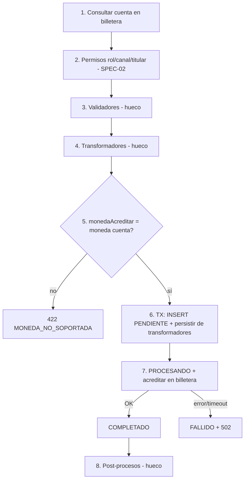

# SPEC-01 · Core: dominio, pipeline y errores

## 1. Metadatos y Tech Stack

**Objetivo:** Definir el depósito, sus estados, el formato de errores y el pipeline con huecos donde se enchufan las features sin modificar el core.

| Depende de | Lo usan | Versión spec |
|---|---|---|
| SPEC-00 | Todas las specs 02 a 10 | 1.0 |

**Stack:** Express 4.21, pg 8.13, decimal.js 10.4, js-yaml 4.1. Pruebas: Jest 29.

## 2. Archivos Involucrados

El Agente tiene permitido leer y modificar ÚNICAMENTE los siguientes archivos:

- [NUEVO] `src/app.js` (Arma Express en el orden de CORE-R10. Sin lógica de negocio).
- [NUEVO] `src/core/db.js` (Pool de pg + helper `enTransaccion(fn)`).
- [NUEVO] `src/core/errores.js` (Clase `ErrorApp(codigo, extra)` + catálogo de §5).
- [NUEVO] `src/core/middlewares/manejadorErrores.js` (Convierte cualquier error al formato de §5).
- [NUEVO] `src/core/cargador.js` (Lee el manifest y registra los módulos activos).
- [NUEVO] `src/core/pipeline.js` (`registrar`, `reintentar`, `leerExtensiones`).
- [NUEVO] `src/core/repositories/depositoRepository.js` (INSERT y cambios de estado de `depositos`).
- [NUEVO] `db/00-core.sql` · `tests/core/pipeline.test.js` · `tests/core/cargador.test.js`

## 3. Flujo del Sistema



## 4. Reglas de Negocio

**Depósito y estados**

| Id | Regla |
|---|---|
| CORE-R01 | Estados: `PENDIENTE → PROCESANDO → COMPLETADO \| FALLIDO`. COMPLETADO es final. |
| CORE-R02 | `FALLIDO → PROCESANDO` solo se permite con `reintentar(depositoId)`, que lo dispara un reintento con la misma Idempotency-Key (SPEC-04). Así billetera recibe el **mismo** `depositoId` y no acredita dos veces. |
| CORE-R03 | `cuenta_destino` y `usuario_id` no son FK: pertenecen a billetera-service y usuario-service. |
| CORE-R04 | La tabla `depositos` no tiene columnas de features. Cada feature tiene su propia tabla con FK a `depositos(id)`. |

**Pipeline** (`pipeline.registrar(datos, contexto)`)

| Id | Regla |
|---|---|
| CORE-R05 | Ejecuta los pasos del diagrama en ese orden. Si un hueco está vacío, sigue de largo. |
| CORE-R06 | Validadores en orden ascendente; el primero que lanza error corta y no se guarda nada. |
| CORE-R07 | Transformadores en cadena. Si no pueden transformar, devuelven el depósito sin cambios. Un error lanzado por un transformador → 500. |
| CORE-R08 | El paso 6 es una sola transacción: INSERT PENDIENTE + `persistir(deposito, tx)` de cada transformador que lo tenga. |
| CORE-R09 | Post-procesos solo si el depósito quedó COMPLETADO. Sus errores se registran en el log y se ignoran. |
| CORE-R10 | Orden en `app.js`: `correlationId` → `auditoria` → `autenticar` (salvo `/health`) → `express.json` → rutas de módulos → 404 `RUTA_NO_ENCONTRADA` → `manejadorErrores`. |

**Contrato de un módulo de extensión** (`src/modules/<id>/index.js`)

```js
module.exports = {
  id: 'limites-por-canal',      // igual al id del manifest
  tipo: 'validador',            // validador | transformador | post-proceso
  errores: { LIMITE_CANAL_EXCEDIDO: { status: 422, mensaje: '...' } }, // opcional
  ejecutar: async (deposito, contexto) => deposito,
  persistir: async (deposito, tx) => {},              // opcional, solo transformador
  leerExtension: async (depositoId, contexto) => null, // opcional, para GET /depositos/{id}
};
```

- `contexto` = `{ usuario, cuenta, correlationId, logger, db, privado }`. `privado` guarda datos internos por módulo que nunca salen en la respuesta.
- Lo que el cliente debe ver va en `deposito.extensiones['<id>']`. Un transformador puede cambiar `deposito.montoAcreditar` y `deposito.monedaAcreditar` (por defecto, monto y moneda).
- Un módulo endpoint exporta `{ id, tipo: 'endpoint', router }`.

**Cargador**

| Id | Regla |
|---|---|
| CORE-R11 | Al arrancar lee `MANIFEST_PATH` y hace `require` solo de las features con `estado: activo`. El `orden` sale del manifest, no del módulo. |
| CORE-R12 | Si una feature activa no existe, o su `tipo` no coincide con el del manifest, el servicio no arranca. |
| CORE-R13 | Registra los `errores` declarados por cada módulo en el catálogo de `errores.js`. |

```sql
CREATE TABLE depositos (
    id              UUID PRIMARY KEY,
    cuenta_destino  VARCHAR(20)   NOT NULL,
    monto           NUMERIC(15,2) NOT NULL CHECK (monto > 0),
    moneda          CHAR(3)       NOT NULL CHECK (moneda IN ('PEN','USD')),
    canal           VARCHAR(20)   NOT NULL CHECK (canal IN ('AGENTE','VENTANILLA','APP')),
    referencia      VARCHAR(140),
    estado          VARCHAR(20)   NOT NULL CHECK (estado IN ('PENDIENTE','PROCESANDO','COMPLETADO','FALLIDO')),
    usuario_id      VARCHAR(50)   NOT NULL,
    creado_en       TIMESTAMPTZ   NOT NULL DEFAULT now(),
    actualizado_en  TIMESTAMPTZ   NOT NULL DEFAULT now()
);
CREATE INDEX idx_depositos_cuenta  ON depositos (cuenta_destino, creado_en DESC);
CREATE INDEX idx_depositos_usuario ON depositos (usuario_id, creado_en DESC);
```

## 5. El Contrato (API Contract)

**Objeto `Deposito`** (lo devuelven SPEC-05 y SPEC-06)
```json
{ "id": "7f1c2e9a-0b1d-4c5e-9f00-123456789abc", "cuentaDestino": "0011-0123-456789",
  "monto": "150.00", "moneda": "PEN", "canal": "AGENTE", "referencia": "Pago alquiler", "estado": "COMPLETADO",
  "creadoEn": "2026-10-13T19:20:00Z", "actualizadoEn": "2026-10-13T19:20:01Z", "extensiones": {} }
```

**Formato de error** (todas las respuestas 4xx y 5xx)
```json
{ "codigo": "MONTO_INVALIDO", "mensaje": "El monto debe ser mayor a 0 y tener hasta 2 decimales.", "correlationId": "abc-123" }
```

| HTTP | Códigos del core (las features agregan los suyos con `errores`) |
|---|---|
| 400 | `FORMATO_INVALIDO`, `IDEMPOTENCY_KEY_REQUERIDA` |
| 401 | `TOKEN_REQUERIDO`, `TOKEN_INVALIDO`, `TOKEN_EXPIRADO` |
| 403 | `SIN_PERMISO` |
| 404 | `DEPOSITO_NO_ENCONTRADO`, `RUTA_NO_ENCONTRADA` |
| 409 | `IDEMPOTENCY_KEY_REUTILIZADA`, `SOLICITUD_EN_PROCESO` |
| 422 | `MONTO_INVALIDO`, `CUENTA_NO_ENCONTRADA`, `CUENTA_INACTIVA`, `MONEDA_NO_SOPORTADA` |
| 500 / 502 | `ERROR_INTERNO` / `BILLETERA_NO_DISPONIBLE` |

## 6. Instrucciones de Ejecución para el Agente

1. **`desarrolladorback`:** Crear los archivos de §2. Un error desconocido se responde como 500 `ERROR_INTERNO` y se registra en el log con su correlationId, nunca con su stack en la respuesta.
2. **`tester`:** Probar el core con módulos falsos (no con las features reales):

| Id | Caso | Esperado |
|---|---|---|
| CORE-T01 | Sin módulos activos | El pipeline llega a COMPLETADO |
| CORE-T02 | Dos validadores con orden 20 y 10 | Corre primero el de orden 10 |
| CORE-T03 | Validador lanza error | No se inserta nada; billetera no se llama |
| CORE-T04 | Transformador con `persistir` que falla | Rollback: 0 filas en `depositos` |
| CORE-T05 | Post-proceso lanza error | Depósito COMPLETADO; error en el log |
| CORE-T06 | Transición COMPLETADO → PROCESANDO | Lanza error |
| CORE-T07 | Manifest con feature activa inexistente | El servicio no arranca |
| CORE-T08 | Ruta inexistente | 404 `RUTA_NO_ENCONTRADA` con formato de error |

3. **`revisor`:** Verificar que `pipeline.js` no conoce ninguna feature por su nombre.

**Criterios de aceptación:**
- ✅ Activar o desactivar una feature en el manifest cambia el comportamiento sin tocar `src/core/`.
- ✅ Todo error del servicio sale con el formato de §5.
