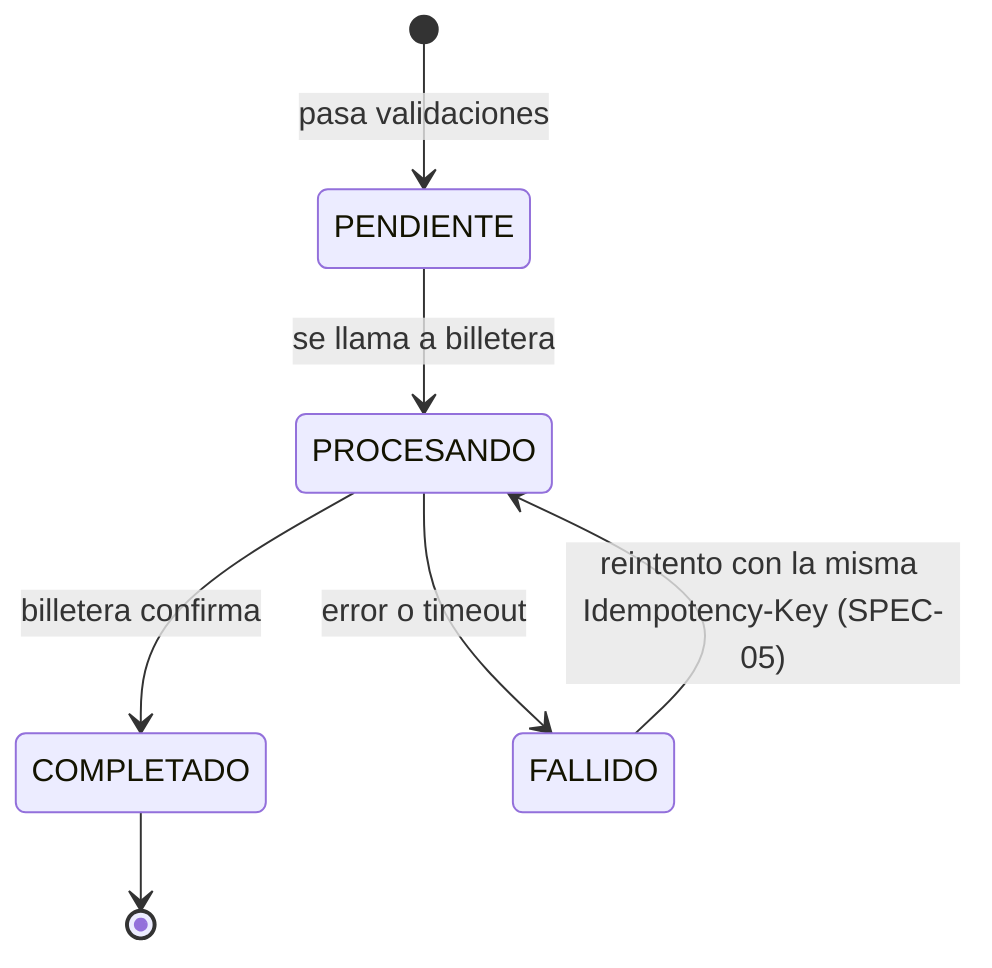

# SPEC-01 · Dominio: depósito, estados y errores

## 1. Metadatos y Tech Stack

**Objetivo:** Definir el depósito, sus estados, su tabla, su forma en JSON y el formato único de errores que usa todo el servicio.

- **Depende de:** SPEC-00.
- **Lo usan:** todas las specs 02 a 12.
- **Versión spec:** 1.1

**Stack:** Express 4.21, pg 8.13, decimal.js 10.4. Pruebas: Jest 29 + Supertest 7.

## 2. Archivos Involucrados

El Agente tiene permitido leer y modificar ÚNICAMENTE los siguientes archivos:

- [NUEVO] `src/core/db.js` (Exporta `pool` y `enTransaccion(fn)`: abre BEGIN, llama `fn(tx)`, COMMIT; ROLLBACK si `fn` lanza).
- [NUEVO] `src/core/errores.js` (Clase `ErrorApp`, catálogo, `registrarErrores(errores)` y `manejar(fn)`).
- [NUEVO] `src/core/middlewares/manejadorErrores.js` (Último middleware: convierte cualquier error al formato de §5).
- [NUEVO] `src/core/depositoMapper.js` (`aJson(fila, extensiones)`: fila de BD → objeto `Deposito` de §5).
- [NUEVO] `db/00-core.sql`
- [NUEVO] `tests/unit/dominio/errores.test.js` · `tests/unit/dominio/depositoMapper.test.js`

## 3. Flujo del Sistema



## 4. Reglas de Negocio

- **DOM-R01** · Solo se permiten las transiciones del diagrama. COMPLETADO es final.
- **DOM-R02** · `FALLIDO → PROCESANDO` solo ocurre en un reintento con la misma Idempotency-Key. Así billetera recibe el **mismo** `depositoId` y no acredita dos veces.
- **DOM-R03** · `cuenta_destino` y `usuario_id` no son FK: pertenecen a billetera-service y a usuario-service.
- **DOM-R04** · `depositos` no tiene columnas de features. Cada feature guarda lo suyo en su tabla con FK a `depositos(id)`.
- **DOM-R05** · `monto_acreditar` y `moneda_acreditar` guardan lo que se pidió acreditar (igual a monto y moneda si nada lo cambió). Son del core porque el reintento los necesita.
- **DOM-R06** · `new ErrorApp(codigo, { depositoId })`: `codigo` es del catálogo; `depositoId` es opcional.
- **DOM-R07** · `manejadorErrores`: si es `ErrorApp`, responde su status y mensaje del catálogo. Si trae `depositoId`, asigna `res.locals.depositoId`. JSON mal formado (`entity.parse.failed`) → 400 `FORMATO_INVALIDO`. Cualquier otro error → 500 `ERROR_INTERNO` y `logger.error` con correlationId; nunca el stack en la respuesta.
- **DOM-R08** · Express 4 no captura errores de funciones `async`: todo controller o middleware `async` se envuelve con `manejar(fn)`, que pasa el error a `next`.
- **DOM-R09** · `registrarErrores({ CODIGO: { status, mensaje } })` agrega códigos de features al catálogo. Si el código ya existe, lanza error.
- **DOM-R10** · `aJson`: nombres en camelCase, `monto` como string con 2 decimales, `referencia` ausente → `null`, fechas ISO 8601 UTC. No expone `usuario_id` ni los campos `*_acreditar`.

```sql
CREATE TABLE depositos (
    id                UUID PRIMARY KEY,
    cuenta_destino    VARCHAR(20)   NOT NULL,
    monto             NUMERIC(15,2) NOT NULL CHECK (monto > 0),
    moneda            CHAR(3)       NOT NULL CHECK (moneda IN ('PEN','USD')),
    monto_acreditar   NUMERIC(15,2) NOT NULL CHECK (monto_acreditar > 0),
    moneda_acreditar  CHAR(3)       NOT NULL CHECK (moneda_acreditar IN ('PEN','USD')),
    canal             VARCHAR(20)   NOT NULL CHECK (canal IN ('AGENTE','VENTANILLA','APP')),
    referencia        VARCHAR(140),
    estado            VARCHAR(20)   NOT NULL CHECK (estado IN ('PENDIENTE','PROCESANDO','COMPLETADO','FALLIDO')),
    usuario_id        VARCHAR(50)   NOT NULL,
    creado_en         TIMESTAMPTZ   NOT NULL DEFAULT now(),
    actualizado_en    TIMESTAMPTZ   NOT NULL DEFAULT now()
);
CREATE INDEX idx_depositos_cuenta  ON depositos (cuenta_destino, creado_en DESC);
CREATE INDEX idx_depositos_usuario ON depositos (usuario_id, creado_en DESC);
```

## 5. El Contrato (API Contract)

**Objeto `Deposito`** (lo devuelven SPEC-07 y SPEC-08)
```json
{ "id": "7f1c2e9a-0b1d-4c5e-9f00-123456789abc", "cuentaDestino": "0011-0123-456789",
  "monto": "150.00", "moneda": "PEN", "canal": "AGENTE", "referencia": "Pago alquiler", "estado": "COMPLETADO",
  "creadoEn": "2026-10-13T19:20:00.000Z", "actualizadoEn": "2026-10-13T19:20:01.000Z", "extensiones": {} }
```

**Formato de error** (toda respuesta 4xx y 5xx)
```json
{ "codigo": "MONTO_INVALIDO", "mensaje": "Monto menor o igual a 0 o con más de 2 decimales.", "correlationId": "abc-123" }
```

**Catálogo del core** (código · status · mensaje):

- `FORMATO_INVALIDO` · 400 · JSON mal formado o campos con tipo incorrecto.
- `IDEMPOTENCY_KEY_REQUERIDA` · 400 · Falta o es inválido el header Idempotency-Key.
- `TOKEN_REQUERIDO` · 401 · Falta el token.
- `TOKEN_INVALIDO` · 401 · Token mal firmado o con issuer/audience incorrectos.
- `TOKEN_EXPIRADO` · 401 · Token vencido.
- `SIN_PERMISO` · 403 · El rol o la cuenta no permiten la operación.
- `DEPOSITO_NO_ENCONTRADO` · 404 · No existe un depósito con ese id.
- `RUTA_NO_ENCONTRADA` · 404 · La ruta no existe.
- `IDEMPOTENCY_KEY_REUTILIZADA` · 409 · Clave usada antes con otros datos.
- `SOLICITUD_EN_PROCESO` · 409 · La solicitud original con esa clave aún se procesa.
- `MONTO_INVALIDO` · 422 · Monto menor o igual a 0 o con más de 2 decimales.
- `CUENTA_NO_ENCONTRADA` · 422 · La cuenta destino no existe.
- `CUENTA_INACTIVA` · 422 · La cuenta destino no está activa.
- `MONEDA_NO_SOPORTADA` · 422 · Moneda distinta a la de la cuenta y sin conversión disponible.
- `ERROR_INTERNO` · 500 · Error no controlado.
- `BILLETERA_NO_DISPONIBLE` · 502 · billetera-service falló o no respondió.

## 6. Instrucciones de Ejecución para el Agente

1. **`desarrolladorback`:** Crear los archivos de §2.
2. **`tester`:**
   - **DOM-T01** · `ErrorApp('MONTO_INVALIDO')` por `manejadorErrores` → 422 con el formato de §5 y el correlationId.
   - **DOM-T02** · Error desconocido → 500 `ERROR_INTERNO`; la respuesta no contiene el stack.
   - **DOM-T03** · JSON mal formado → 400 `FORMATO_INVALIDO`.
   - **DOM-T04** · `ErrorApp('BILLETERA_NO_DISPONIBLE', { depositoId: 'x' })` → `res.locals.depositoId === 'x'`.
   - **DOM-T05** · `registrarErrores` con un código ya existente → lanza error.
   - **DOM-T06** · `aJson` con monto `150` y sin referencia → `"150.00"` y `referencia: null`.
   - **DOM-T07** · Controller `async` que lanza, envuelto en `manejar` → responde el error (no se cuelga).
   - **DOM-T08** · `enTransaccion` cuya función lanza → ninguna fila insertada.
3. **`revisor`:** Verificar DOM-R07, DOM-R08 y DOM-R10.

**Criterios de aceptación:**
- ✅ Todo error del servicio sale con el mismo formato y un código del catálogo.
- ✅ El objeto `Deposito` tiene la misma forma en todas las respuestas.
