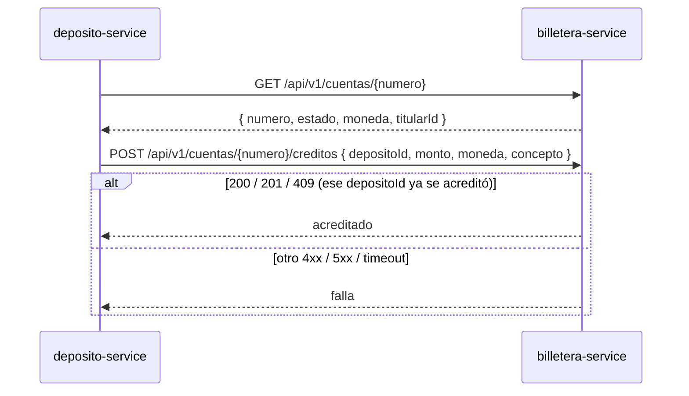

# SPEC-02 · Integraciones: billetera-service y usuario-service

## 1. Metadatos y Tech Stack

**Objetivo:** Definir el contrato que **proponemos** a los otros equipos, el cliente HTTP que lo usa y los mocks y datos de prueba que lo respetan mientras se acuerda.

- **Estado:** [POR ACORDAR] con los equipos de billetera y de usuario. Esto es la PROPUESTA de deposito-service.
- **Depende de:** SPEC-00, SPEC-01 (`ErrorApp`).
- **Lo usan:** SPEC-03 (JWT), SPEC-07 (consultar y acreditar), SPEC-08 y SPEC-09 (titular de la cuenta).
- **Versión spec:** 1.1

**Stack:** axios 1.7.9 (cliente), Express 4.21 (mock), jsonwebtoken 9.0.2. Pruebas: nock 13.5.

## 2. Archivos Involucrados

El Agente tiene permitido leer y modificar ÚNICAMENTE los siguientes archivos:

- [NUEVO] `src/core/clients/billeteraClient.js` (Único lugar que conoce `BILLETERA_URL`. Exporta `consultarCuenta(numero, correlationId)` y `acreditar(datos, correlationId)`).
- [NUEVO] `mocks/billetera/server.js` · `mocks/billetera/Dockerfile` (Mock en memoria, puerto 4000, que respeta §5).
- [NUEVO] `tests/helpers/billetera.js` (Helpers de nock: `cuentaActiva`, `cuentaNoExiste`, `consultaFalla`, `acreditaOk`, `acreditaFalla`, `acreditaLento`, `acreditaYaExiste`).
- [NUEVO] `tests/helpers/tokens.js` (`token(usuario, { exp, aud, clave, alg })` con el par RSA de `tests/.tmp/`).
- [NUEVO] `scripts/generar-claves-dev.js` (Par RSA de desarrollo en `.dev-keys/`).
- [NUEVO] `scripts/generar-token.js` (`node scripts/generar-token.js usr-agente-1`).
- [NUEVO] `tests/unit/integraciones/billeteraClient.test.js`

## 3. Flujo del Sistema



## 4. Reglas de Negocio

- **INT-R01** · Solo HTTP. Nunca acceso a la base de datos de otro servicio.
- **INT-R02** · Toda llamada envía `Authorization: Bearer <BILLETERA_TOKEN>` y `X-Correlation-Id`. La autenticación real entre servicios está [POR ACORDAR].
- **INT-R03** · Timeout `BILLETERA_TIMEOUT_MS` en ambas llamadas.
- **INT-R04** · `consultarCuenta`: 200 → devuelve `{ numero, estado, moneda, titularId }`; 404 → devuelve `null`; otro status o timeout → lanza `ErrorApp('BILLETERA_NO_DISPONIBLE')`.
- **INT-R05** · `acreditar({ depositoId, cuenta, monto, moneda })`: 200, 201 o 409 → resuelve sin valor; otro status o timeout → lanza `ErrorApp('BILLETERA_NO_DISPONIBLE')`.
- **INT-R06** · Sin reintentos automáticos en `acreditar`. La protección contra doble acreditación es el `depositoId`, que billetera usa como clave de idempotencia.
- **INT-R07** · `monto` viaja como string con 2 decimales. `concepto` siempre es `"DEPOSITO"`.
- **INT-R08** · El JWT se valida localmente (SPEC-03). Nunca se llama a usuario-service por petición.

**Datos de prueba compartidos** (los usan el mock y los helpers; ninguna prueba inventa otros):

- **Cuentas:** `0011-0123-456789` ACTIVA PEN, titular `usr-cliente-1` · `0011-0123-000002` ACTIVA USD, titular `usr-cliente-2` · `0011-0123-000003` BLOQUEADA PEN, titular `usr-cliente-1`.
- **Cuentas especiales del mock:** `0011-0123-999999` ACTIVA PEN, responde 500 al acreditar · `0011-0123-888888` ACTIVA PEN, tarda 6 s al acreditar.
- **Usuarios:** `usr-cliente-1` y `usr-cliente-2` (CLIENTE) · `usr-agente-1` y `usr-agente-2` (AGENTE) · `usr-cajero-1` (CAJERO).
- **INT-R09** · El mock guarda en memoria los `depositoId` acreditados y responde 409 si se repiten.

## 5. El Contrato (API Contract)

**billetera · Consultar cuenta:** `GET /api/v1/cuentas/{numero}` → **HTTP 200**
```json
{ "numero": "0011-0123-456789", "estado": "ACTIVA", "moneda": "PEN", "titularId": "usr-cliente-1" }
```
**HTTP 404** si la cuenta no existe.

**billetera · Acreditar:** `POST /api/v1/cuentas/{numero}/creditos`
```json
{ "depositoId": "7f1c2e9a-0b1d-4c5e-9f00-123456789abc", "monto": "150.00", "moneda": "PEN", "concepto": "DEPOSITO" }
```
**HTTP 201** si acreditó · **HTTP 409** si ese `depositoId` ya fue acreditado.

**usuario · Payload propuesto del JWT** (firma RS256 [POR ACORDAR])
```json
{ "sub": "usr-cliente-1", "roles": ["CLIENTE"], "iss": "usuario-service", "aud": "banco-api", "exp": 1760000000 }
```

- `sub` → `usuario_id` en depósitos, idempotencia y auditoría.
- `roles` → CLIENTE, AGENTE o CAJERO (SPEC-03).
- `iss`, `aud`, `exp` → validación del token.

## 6. Instrucciones de Ejecución para el Agente

1. **`desarrolladorback`:** Crear los archivos de §2. El mock es para probar a mano con `docker compose`; las pruebas automáticas usan nock.
2. **`tester`:**
   - **INT-T01** · Consultar con 200 → devuelve la cuenta.
   - **INT-T02** · Consultar con 404 → devuelve `null`.
   - **INT-T03** · Consultar con 500 y con timeout → `BILLETERA_NO_DISPONIBLE`.
   - **INT-T04** · Acreditar con 201 y con 409 → resuelve.
   - **INT-T05** · Acreditar con 400, 500 y timeout → `BILLETERA_NO_DISPONIBLE`; nock recibió 1 sola llamada.
   - **INT-T06** · Cualquier llamada → lleva `Authorization` y `X-Correlation-Id`.
   - **INT-T07** · `acreditar` con monto `Decimal(150)` → el body lleva `"150.00"`.
3. **`revisor`:** Verificar INT-R06 y que ninguna URL de billetera aparece fuera de `billeteraClient.js` y `.env.example`.

**Criterios de aceptación:**
- ✅ El servicio funciona de punta a punta con el mock mientras los otros equipos confirman.
- ✅ Cambiar al billetera-service real solo requiere cambiar `BILLETERA_URL` y `BILLETERA_TOKEN`.
