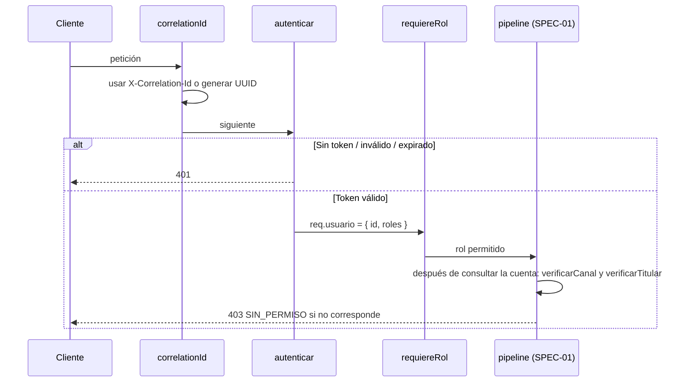

# SPEC-02 · Seguridad: correlation id, JWT y permisos

## 1. Metadatos y Tech Stack

**Objetivo:** Que solo usuarios autenticados operen, cada uno según su rol y canal, y que toda petición sea rastreable con un correlation id.

| Campo | Valor |
|---|---|
| Tipo | transversal (siempre activa) |
| Depende de | SPEC-01 (errores), SPEC-10 (formato del token de usuario-service) |
| Versión spec | 1.0 |

**Stack:** Express 4.21, jsonwebtoken 9.0.2. Pruebas: Jest 29 + Supertest 7, tokens firmados en el test con un par de claves propio.

## 2. Archivos Involucrados

El Agente tiene permitido leer y modificar ÚNICAMENTE los siguientes archivos:

- [NUEVO] `src/core/middlewares/correlationId.js` (Global. Lee o genera el id).
- [NUEVO] `src/core/middlewares/autenticar.js` (Global, salvo `/health`. Valida el JWT localmente).
- [NUEVO] `src/core/middlewares/requiereRol.js` (Por ruta: `requiereRol('CLIENTE','AGENTE','CAJERO')`).
- [NUEVO] `src/core/permisos.js` (`verificarCanal`, `verificarTitular`, `esTitular`).
- [NUEVO] `tests/helpers/tokens.js` (Genera tokens válidos, expirados, con otra clave o con otro `aud`).
- [NUEVO] `tests/integration/seguridad.test.js` · `tests/unit/permisos.test.js`

## 3. Flujo del Sistema



## 4. Reglas de Negocio

**Correlation id**

| Id | Regla |
|---|---|
| SEG-R01 | Si llega `X-Correlation-Id` con 1 a 100 caracteres `[A-Za-z0-9-_]`, se usa. Si no, se genera un UUID. |
| SEG-R02 | Se devuelve en el header `X-Correlation-Id` de toda respuesta, en todo cuerpo de error y se envía a billetera-service. |

**Autenticación**

| Id | Regla |
|---|---|
| SEG-R03 | Sin header `Authorization: Bearer <token>` → 401 `TOKEN_REQUERIDO`. |
| SEG-R04 | `jwt.verify` fija `algorithms`, `issuer` y `audience` desde las variables de entorno. Nunca acepta `alg: none`. |
| SEG-R05 | Token vencido → 401 `TOKEN_EXPIRADO`. Cualquier otro fallo, o un token sin `sub` o sin `roles` → 401 `TOKEN_INVALIDO`. |
| SEG-R06 | Se valida localmente con `JWT_PUBLIC_KEY`. Nunca se llama a usuario-service por petición. |
| SEG-R07 | Token válido → `req.usuario = { id: sub, roles }`. |

**Autorización**

| Rol | Canal que puede usar | Puede depositar a | Puede consultar |
|---|---|---|---|
| CLIENTE | APP | Solo cuentas propias | Solo depósitos de cuentas propias |
| AGENTE | AGENTE | Cualquier cuenta | Solo depósitos que él registró |
| CAJERO | VENTANILLA | Cualquier cuenta | Solo depósitos que él registró |

| Id | Regla |
|---|---|
| SEG-R08 | `requiereRol(...)`: si ningún rol del usuario está en la lista → 403 `SIN_PERMISO`. |
| SEG-R09 | `verificarCanal(usuario, canal)`: el canal del depósito debe corresponder a un rol del usuario según la tabla. Si no → 403. |
| SEG-R10 | `verificarTitular(usuario, cuenta)`: si el usuario solo es CLIENTE y `cuenta.titularId !== usuario.id` → 403. |
| SEG-R11 | En el depósito, el core llama a `verificarCanal` y `verificarTitular` justo después de consultar la cuenta y antes de los validadores (SPEC-01 paso 2). |
| SEG-R12 | Logs: siempre correlationId, usuarioId, ruta, status y duración. Nunca token ni cuenta completa (PRY-R10). |

## 5. El Contrato (API Contract)

No agrega rutas. Aplica a todas, salvo `GET /health`.

**Headers de entrada:** `Authorization: Bearer <jwt>` (obligatorio), `X-Correlation-Id` (opcional).
**Header de salida:** `X-Correlation-Id` (siempre).

**Response HTTP 401**
```json
{ "codigo": "TOKEN_EXPIRADO", "mensaje": "El token ha expirado.", "correlationId": "abc-123" }
```

**Response HTTP 403**
```json
{ "codigo": "SIN_PERMISO", "mensaje": "No tiene permiso para realizar esta operación.", "correlationId": "abc-123" }
```

## 6. Instrucciones de Ejecución para el Agente

1. **`desarrolladorback`:** Crear los archivos de §2. `permisos.js` no hace HTTP: recibe la cuenta ya consultada.
2. **`desarrolladorfront`:** Ante 401, volver al login. Ante 403, mostrar "No tiene permiso para esta operación".
3. **`tester`:** Crear estas pruebas, con el id en el nombre:

| Id | Caso | Esperado |
|---|---|---|
| SEG-T01 | POST /depositos sin `Authorization` | 401 `TOKEN_REQUERIDO` |
| SEG-T02 | Token con `exp` en el pasado | 401 `TOKEN_EXPIRADO` |
| SEG-T03 | Token firmado con otra clave | 401 `TOKEN_INVALIDO` |
| SEG-T04 | Token con `alg: none` | 401 `TOKEN_INVALIDO` |
| SEG-T05 | Token con `aud` distinto | 401 `TOKEN_INVALIDO` |
| SEG-T06 | CLIENTE deposita a cuenta con otro `titularId` | 403; billetera no recibe acreditación |
| SEG-T07 | CLIENTE usa canal VENTANILLA | 403 `SIN_PERMISO` |
| SEG-T08 | Petición sin `X-Correlation-Id` | Respuesta con header no vacío |
| SEG-T09 | Petición con `X-Correlation-Id: abc` | Respuesta con `abc`; billetera mock recibió `abc` |
| SEG-T10 | Error 500 forzado | El log no contiene el token ni la cuenta completa |

4. **`revisor`:** Verificar SEG-R04, SEG-R06 y que `requiereRol` está en todas las rutas de negocio.

**Criterios de aceptación:**
- ✅ Ninguna ruta de negocio responde sin un token válido.
- ✅ Un CLIENTE no puede depositar ni consultar cuentas ajenas.
- ✅ Toda respuesta trae `X-Correlation-Id`.
