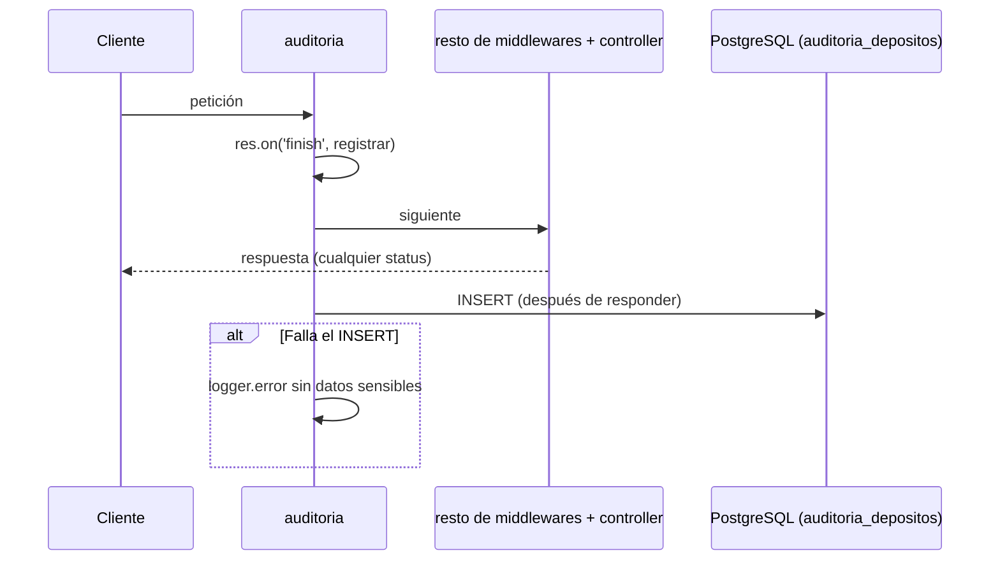

# SPEC-03 · Auditoría

## 1. Metadatos y Tech Stack

**Objetivo:** Registrar cada intento de operación (quién, cuándo, desde dónde, qué, cuánto y con qué resultado) sin bloquear ni cambiar nunca la respuesta.

| Campo | Valor |
|---|---|
| Tipo | transversal (siempre activa) |
| Depende de | SPEC-01, SPEC-02 (correlation id) |
| Versión spec | 1.0 |

**Stack:** Express 4.21, pg 8.13. Pruebas: Jest 29 + Supertest 7.

## 2. Archivos Involucrados

El Agente tiene permitido leer y modificar ÚNICAMENTE los siguientes archivos:

- [NUEVO] `src/core/middlewares/auditoria.js` (Global. Va **antes** de `autenticar` para registrar también los 401).
- [NUEVO] `src/core/repositories/auditoriaRepository.js` (Solo INSERT).
- [NUEVO] `db/03-auditoria.sql` (Tabla + trigger de inmutabilidad).
- [NUEVO] `tests/integration/auditoria.test.js`

## 3. Flujo del Sistema



## 4. Reglas de Negocio

| Id | Regla |
|---|---|
| AUD-R01 | Se registra TODO intento a las rutas auditadas, incluso 400, 401, 403, 409, 422, 5xx y repeticiones idempotentes. |
| AUD-R02 | La acción se deduce del método y la ruta (tabla de abajo). Rutas no listadas (`/health`, 404) no se auditan. |
| AUD-R03 | El registro se hace en `res.on('finish')`, después de enviar la respuesta. No agrega latencia. |
| AUD-R04 | Si el INSERT falla, se escribe en el log y la respuesta al cliente no cambia. |
| AUD-R05 | La tabla es solo de inserción: un trigger bloquea UPDATE y DELETE. |
| AUD-R06 | `usuario_id` es nulo si no hubo token válido. `deposito_id` sale de `res.locals.depositoId` y es nulo si no hubo depósito. |
| AUD-R07 | `canal` y `monto` se toman del body solo si son válidos; si no, nulos. Nunca se guarda el body completo. |
| AUD-R08 | `resultado`: `EXITO` si status < 400, si no `ERROR_<status>` (ej. `ERROR_422`). |

| Método y ruta | accion |
|---|---|
| `POST /api/v1/depositos` | `CREAR_DEPOSITO` |
| `GET /api/v1/depositos/{id}` | `CONSULTAR_DEPOSITO` |
| `GET /api/v1/cuentas/{numero}/depositos` | `LISTAR_DEPOSITOS` |

```sql
CREATE TABLE auditoria_depositos (
    id              BIGSERIAL PRIMARY KEY,
    deposito_id     UUID REFERENCES depositos(id),
    usuario_id      VARCHAR(50),
    accion          VARCHAR(40)  NOT NULL,
    ip              VARCHAR(45),
    canal           VARCHAR(20),
    monto           NUMERIC(15,2),
    resultado       VARCHAR(20)  NOT NULL,
    correlation_id  VARCHAR(100),
    creado_en       TIMESTAMPTZ  NOT NULL DEFAULT now()
);

CREATE FUNCTION bloquear_cambios_auditoria() RETURNS trigger AS $$
BEGIN RAISE EXCEPTION 'auditoria_depositos es solo de inserción'; END;
$$ LANGUAGE plpgsql;

CREATE TRIGGER auditoria_inmutable BEFORE UPDATE OR DELETE ON auditoria_depositos
FOR EACH ROW EXECUTE FUNCTION bloquear_cambios_auditoria();
```

## 5. El Contrato (API Contract)

No agrega rutas ni cambia ninguna respuesta. Lo único que exige a otros módulos: el controller asigna `res.locals.depositoId` cuando hay un depósito involucrado (SPEC-05 y SPEC-06).

## 6. Instrucciones de Ejecución para el Agente

1. **`desarrolladorback`:** Crear los archivos de §2. La limpieza de tablas en pruebas debe usar `TRUNCATE` (el trigger no bloquea TRUNCATE).
2. **`tester`:** La auditoría se escribe después de responder: esperar con un reintento corto antes de consultar la tabla.

| Id | Caso | Esperado |
|---|---|---|
| AUD-T01 | Depósito válido | 1 fila `CREAR_DEPOSITO`, `EXITO`, `deposito_id` lleno, `correlation_id` igual al de la respuesta |
| AUD-T02 | Monto `"-5"` | 1 fila `ERROR_422`, `deposito_id` nulo |
| AUD-T03 | POST sin token | 1 fila `ERROR_401`, `usuario_id` nulo |
| AUD-T04 | 3 POST con la misma clave | 3 filas `CREAR_DEPOSITO`, 1 solo depósito |
| AUD-T05 | `UPDATE` y `DELETE` directos en SQL | Ambos lanzan excepción |
| AUD-T06 | Forzar error en el INSERT de auditoría | Respuesta 201 normal; error en el log sin cuenta completa |
| AUD-T07 | `GET /depositos/{id}` | 1 fila `CONSULTAR_DEPOSITO` |
| AUD-T08 | `GET /health` | 0 filas |

3. **`revisor`:** Verificar AUD-R03, AUD-R04 y AUD-R07.

**Criterios de aceptación:**
- ✅ Todo intento queda registrado, exitoso o no.
- ✅ Nadie puede modificar ni borrar un registro de auditoría.
- ✅ Un fallo de auditoría nunca afecta al cliente.
