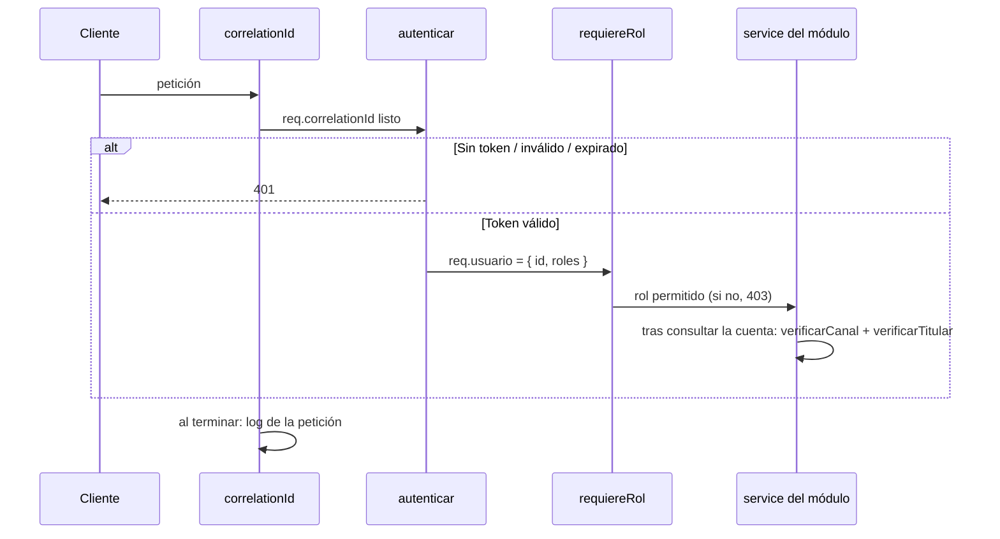

# SPEC-03 · Seguridad: correlation id, JWT y permisos

## 1. Metadatos y Tech Stack

**Objetivo:** Que solo usuarios autenticados operen, cada uno según su rol y canal, y que toda petición sea rastreable y quede en el log.

- **Tipo:** transversal (siempre activa).
- **Depende de:** SPEC-01 (`ErrorApp`), SPEC-02 (formato del token y helpers de prueba).
- **Versión spec:** 1.1

**Stack:** Express 4.21, jsonwebtoken 9.0.2. Pruebas: Jest 29 + Supertest 7.

## 2. Archivos Involucrados

El Agente tiene permitido leer y modificar ÚNICAMENTE los siguientes archivos:

- [NUEVO] `src/core/middlewares/correlationId.js` (Global. Lee o genera el id y escribe el log de cada petición al terminar).
- [NUEVO] `src/core/middlewares/auth.js` (Exporta `autenticar` (global, salvo `/health`) y `requiereRol(...roles)` (por ruta)).
- [NUEVO] `src/core/permisos.js` (Funciones puras: `verificarCanal`, `verificarTitular`, `esTitular`. No hacen HTTP).
- [NUEVO] `tests/unit/seguridad/permisos.test.js` · `tests/integration/seguridad/seguridad.test.js`

## 3. Flujo del Sistema



## 4. Reglas de Negocio

**Correlation id y log**
- **SEG-R01** · Si llega `X-Correlation-Id` con 1 a 100 caracteres `[A-Za-z0-9_-]`, se usa; si no, se genera con `crypto.randomUUID()`. Queda en `req.correlationId`.
- **SEG-R02** · Se devuelve en el header `X-Correlation-Id` de toda respuesta, en todo cuerpo de error y se envía a billetera.
- **SEG-R03** · Al terminar cada petición (`res.on('finish')`), `logger.info` con: correlationId, usuarioId (o null), método, ruta, status y duración en ms. Nunca token ni cuenta completa.

**Autenticación** (`autenticar`)
- **SEG-R04** · Sin header `Authorization: Bearer <token>` → 401 `TOKEN_REQUERIDO`.
- **SEG-R05** · `jwt.verify` con `algorithms`, `issuer` y `audience` de la configuración. Nunca acepta `alg: none`.
- **SEG-R06** · Token vencido (`TokenExpiredError`) → 401 `TOKEN_EXPIRADO`. Cualquier otro fallo, o un token sin `sub` o sin `roles` (arreglo no vacío) → 401 `TOKEN_INVALIDO`.
- **SEG-R07** · Se valida localmente con `JWT_PUBLIC_KEY`. Nunca se llama a usuario-service.
- **SEG-R08** · Token válido → `req.usuario = { id: sub, roles }`.

**Autorización**

| Rol     | Canal      | Puede depositar a     | Puede consultar                    |
|---------|------------|-----------------------|------------------------------------|
| CLIENTE | APP        | Solo cuentas propias  | Solo depósitos de cuentas propias  |
| AGENTE  | AGENTE     | Cualquier cuenta      | Solo depósitos que él registró     |
| CAJERO  | VENTANILLA | Cualquier cuenta      | Solo depósitos que él registró     |

- **SEG-R09** · `requiereRol(...roles)`: si ningún rol del usuario está en la lista → 403 `SIN_PERMISO`.
- **SEG-R10** · `verificarCanal(usuario, canal)`: si ningún rol del usuario corresponde a ese canal según la tabla → lanza 403 `SIN_PERMISO`.
- **SEG-R11** · `verificarTitular(usuario, canal, cuenta)`: si `canal` es APP (rol CLIENTE) y `cuenta.titularId !== usuario.id` → lanza 403 `SIN_PERMISO`. AGENTE y CAJERO pueden depositar a cualquier cuenta.
- **SEG-R12** · `esTitular(usuario, cuenta)` → `true` si `cuenta` no es null y `cuenta.titularId === usuario.id`.
- **SEG-R13** · Un token con varios roles: [POR ACORDAR]. Mientras tanto se permite y se aplican las reglas de cada rol que tenga.

## 5. El Contrato (API Contract)

No agrega rutas. Aplica a todas, salvo `GET /health`.

- **Headers de entrada:** `Authorization: Bearer <jwt>` (obligatorio), `X-Correlation-Id` (opcional).
- **Header de salida:** `X-Correlation-Id` (siempre).

**Response HTTP 401**
```json
{ "codigo": "TOKEN_EXPIRADO", "mensaje": "Token vencido.", "correlationId": "abc-123" }
```

**Response HTTP 403**
```json
{ "codigo": "SIN_PERMISO", "mensaje": "El rol o la cuenta no permiten la operación.", "correlationId": "abc-123" }
```

## 6. Instrucciones de Ejecución para el Agente

1. **`desarrolladorback`:** Crear los archivos de §2.
2. **`desarrolladorfront`:** Ante 401, volver al inicio de sesión. Ante 403, mostrar "No tiene permiso para esta operación".
3. **`tester`:** Los casos T01–T05 y T07–T09 montan los middlewares en una app Express mínima dentro del test.
   - **SEG-T01** · Sin header `Authorization` → 401 `TOKEN_REQUERIDO`.
   - **SEG-T02** · Token con `exp` en el pasado → 401 `TOKEN_EXPIRADO`.
   - **SEG-T03** · Token firmado con otra clave → 401 `TOKEN_INVALIDO`.
   - **SEG-T04** · Token con `alg: none` → 401 `TOKEN_INVALIDO`.
   - **SEG-T05** · Token con `aud` distinto → 401 `TOKEN_INVALIDO`.
   - **SEG-T06** · (requiere SPEC-07) `usr-cliente-1` deposita a `0011-0123-000002` → 403; billetera no recibe acreditación.
   - **SEG-T07** · `verificarCanal` con CLIENTE y canal VENTANILLA → lanza `SIN_PERMISO`.
   - **SEG-T08** · Sin `X-Correlation-Id` → la respuesta trae uno no vacío. Con `abc` → la respuesta trae `abc`.
   - **SEG-T09** · Error 500 forzado → el log no contiene el token ni la cuenta completa; sí contiene status y duración.
   - **SEG-T10** · `requiereRol('AGENTE')` con token CLIENTE → 403 `SIN_PERMISO`.
4. **`revisor`:** Verificar SEG-R05, SEG-R07 y que `requiereRol` está en todas las rutas de negocio.

**Criterios de aceptación:**
- ✅ Ninguna ruta de negocio responde sin un token válido.
- ✅ Un CLIENTE no puede depositar ni consultar cuentas ajenas.
- ✅ Toda petición queda en el log con su correlation id.
