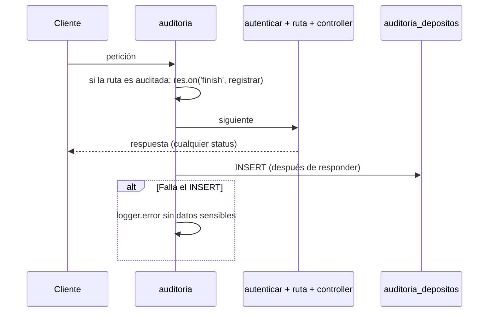

# SPEC-04 · Auditoría

## 1. Metadatos y Tech Stack

**Objetivo:** Registrar cada intento de operación (quién, cuándo, desde dónde, qué, cuánto y con qué resultado) sin bloquear ni cambiar nunca la respuesta.

- **Tipo:** transversal (siempre activa).
- **Depende de:** SPEC-01 (tabla `depositos`), SPEC-03 (`req.correlationId`, `req.usuario`).
- **Versión spec:** 1.1

**Stack:** Express 4.21, pg 8.13. Pruebas: Jest 29 + Supertest 7.

## 2. Archivos Involucrados

El Agente tiene permitido leer y modificar ÚNICAMENTE los siguientes archivos:

- [NUEVO] `src/core/middlewares/auditoria.js` (Global. Va **antes** de `autenticar`, para registrar también los 401).
- [NUEVO] `src/core/repositories/auditoriaRepository.js` (Solo `insertar`).
- [NUEVO] `db/04-auditoria.sql` (Tabla + trigger de inmutabilidad).
- [NUEVO] `tests/integration/auditoria/auditoria.test.js`

## 3. Flujo del Sistema



## 4. Reglas de Negocio

- **AUD-R01** · Se registra TODO intento a una ruta auditada, cualquiera sea el status, incluso las respuestas repetidas por idempotencia.
- **AUD-R02** · La acción se deduce del método y la ruta (lista de abajo). Rutas no listadas (`/health`, rutas inexistentes) no se auditan.
- **AUD-R03** · El INSERT se hace en `res.on('finish')`, después de enviar la respuesta: no agrega latencia ni se espera.
- **AUD-R04** · Si el INSERT falla → `logger.error` con correlationId y acción; la respuesta no cambia.
- **AUD-R05** · La tabla es solo de inserción: un trigger bloquea UPDATE y DELETE. La limpieza en pruebas usa `TRUNCATE`.
- **AUD-R06** · `usuario_id` = `req.usuario?.id` (null si no hubo token válido). `deposito_id` = `res.locals.depositoId` (null si no hubo depósito).
- **AUD-R07** · `canal` se guarda solo si es AGENTE, VENTANILLA o APP. `monto` se guarda solo si es un string que cumple `^-?\d{1,13}(\.\d{1,2})?$`. Si no, null. Nunca se guarda el body completo.
- **AUD-R08** · `ip` = `req.ip` (con `trust proxy` configurado en SPEC-06). `resultado` = `EXITO` si status < 400; si no, `ERROR_<status>` (ej. `ERROR_422`).

**Acciones auditadas:**
- `POST /api/v1/depositos` → `CREAR_DEPOSITO`
- `GET /api/v1/depositos/{id}` → `CONSULTAR_DEPOSITO`
- `GET /api/v1/cuentas/{numero}/depositos` → `LISTAR_DEPOSITOS`

```sql
CREATE TABLE auditoria_depositos (
    id              BIGSERIAL PRIMARY KEY,
    deposito_id     UUID REFERENCES depositos(id),
    usuario_id      VARCHAR(50),
    accion          VARCHAR(40)  NOT NULL,
    ip              VARCHAR(45),
    canal           VARCHAR(20),
    monto           NUMERIC(15,2),
    resultado       VARCHAR(20)  NOT NULL,
    correlation_id  VARCHAR(100),
    creado_en       TIMESTAMPTZ  NOT NULL DEFAULT now()
);

CREATE FUNCTION bloquear_cambios_auditoria() RETURNS trigger AS $$
BEGIN RAISE EXCEPTION 'auditoria_depositos es solo de inserción'; END;
$$ LANGUAGE plpgsql;

CREATE TRIGGER auditoria_inmutable BEFORE UPDATE OR DELETE ON auditoria_depositos
FOR EACH ROW EXECUTE FUNCTION bloquear_cambios_auditoria();
```

## 5. El Contrato (API Contract)

No agrega rutas ni cambia ninguna respuesta. Lo que exige a otros: quien conozca el depósito involucrado asigna `res.locals.depositoId` (controllers de SPEC-07 y SPEC-08, `manejadorErrores` de SPEC-01 e idempotencia de SPEC-05 al repetir).

## 6. Instrucciones de Ejecución para el Agente

1. **`desarrolladorback`:** Crear los archivos de §2.
2. **`tester`:** La auditoría se escribe después de responder: consultar la tabla con reintentos cortos (hasta 1 s). Los casos que piden un depósito real requieren SPEC-07.
   - **AUD-T01** · Depósito válido → 1 fila `CREAR_DEPOSITO`, `EXITO`, `deposito_id` lleno, `correlation_id` igual al de la respuesta.
   - **AUD-T02** · Monto `"-5"` → 1 fila `ERROR_422`, `deposito_id` nulo, `monto` -5.00.
   - **AUD-T03** · POST sin token → 1 fila `ERROR_401`, `usuario_id` nulo.
   - **AUD-T04** · 3 POST iguales con la misma clave → 3 filas `CREAR_DEPOSITO` con el mismo `deposito_id`; 1 solo depósito.
   - **AUD-T05** · `UPDATE` y `DELETE` directos en SQL → ambos lanzan excepción.
   - **AUD-T06** · Forzar error en el INSERT → la respuesta 201 llega normal; `logger.error` sin cuenta completa.
   - **AUD-T07** · `GET /depositos/{id}` → 1 fila `CONSULTAR_DEPOSITO`.
   - **AUD-T08** · `GET /health` → 0 filas.
3. **`revisor`:** Verificar AUD-R03, AUD-R04 y AUD-R07.

**Criterios de aceptación:**
- ✅ Todo intento queda registrado, exitoso o no.
- ✅ Nadie puede modificar ni borrar un registro de auditoría.
- ✅ Un fallo de auditoría nunca afecta al cliente.
