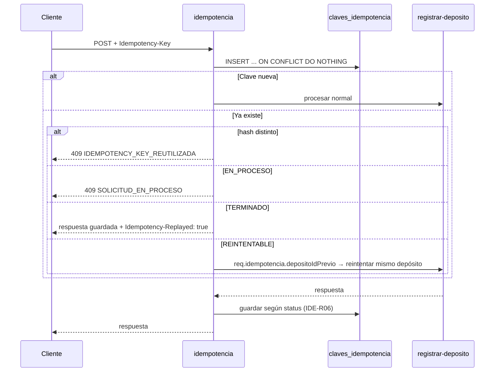

# SPEC-04 · Idempotencia

## 1. Metadatos y Tech Stack

**Objetivo:** Que un reintento del cliente nunca acredite dos veces, aunque la respuesta original se haya perdido o billetera no haya respondido a tiempo.

| Campo | Valor |
|---|---|
| Tipo | transversal, solo en `POST /api/v1/depositos` |
| Depende de | SPEC-01 (`reintentar`), SPEC-02 (`req.usuario`) |
| Versión spec | 1.0 |

**Stack:** Express 4.21, pg 8.13, `node:crypto` (SHA-256). Pruebas: Jest 29 + Supertest 7 + nock 13.

## 2. Archivos Involucrados

El Agente tiene permitido leer y modificar ÚNICAMENTE los siguientes archivos:

- [NUEVO] `src/core/middlewares/idempotencia.js` (Reserva la clave y guarda la respuesta).
- [NUEVO] `src/core/repositories/idempotenciaRepository.js` (Reservar, leer, guardar, borrar, limpiar).
- [NUEVO] `src/core/tareas/limpiarClaves.js` (Cada hora borra claves con más de `IDEMPOTENCIA_DIAS`).
- [NUEVO] `db/04-idempotencia.sql`
- [NUEVO] `tests/integration/idempotencia.test.js`

## 3. Flujo del Sistema



## 4. Reglas de Negocio

| Id | Regla |
|---|---|
| IDE-R01 | Header `Idempotency-Key` obligatorio, de 8 a 100 caracteres. Si falta o no cumple → 400 `IDEMPOTENCY_KEY_REQUERIDA`. |
| IDE-R02 | La clave es única **por usuario**: PK `(usuario_id, clave)`. |
| IDE-R03 | `hash_solicitud` = SHA-256 de método + ruta + body serializado con las llaves ordenadas. |
| IDE-R04 | La reserva es atómica con `INSERT ... ON CONFLICT DO NOTHING`. Nunca "SELECT y luego INSERT". |
| IDE-R05 | Si la clave existe: aplicar el `alt` del diagrama. En `REINTENTABLE`, pasar a `EN_PROCESO` con `UPDATE ... WHERE estado = 'REINTENTABLE'`. Si no actualiza ninguna fila (otra petición ganó) → 409 `SOLICITUD_EN_PROCESO`. |
| IDE-R06 | Se intercepta `res.json` y se guarda **antes** de enviar: status < 500 → `TERMINADO` con status, cuerpo y `deposito_id`; 502 con `depositoId` (falló la acreditación) → `REINTENTABLE` con `deposito_id`; otro 5xx sin depósito → se borra la clave. |
| IDE-R07 | Un reintento `REINTENTABLE` no repite validadores ni transformadores: llama a `pipeline.reintentar(depositoId)` (SPEC-01, CORE-R02). |
| IDE-R08 | Las claves duran `IDEMPOTENCIA_DIAS` (por defecto 7). `limpiarClaves` las borra cada hora. |

| Estado de la clave | Significado |
|---|---|
| `EN_PROCESO` | La petición se está atendiendo |
| `TERMINADO` | Hay respuesta guardada; se repite tal cual |
| `REINTENTABLE` | Billetera falló al acreditar; el reintento reusa el mismo depósito |

```sql
CREATE TABLE claves_idempotencia (
    usuario_id      VARCHAR(50)  NOT NULL,
    clave           VARCHAR(100) NOT NULL,
    hash_solicitud  CHAR(64)     NOT NULL,
    estado          VARCHAR(20)  NOT NULL CHECK (estado IN ('EN_PROCESO','TERMINADO','REINTENTABLE')),
    status_http     SMALLINT,
    respuesta       JSONB,
    deposito_id     UUID REFERENCES depositos(id),
    creado_en       TIMESTAMPTZ  NOT NULL DEFAULT now(),
    PRIMARY KEY (usuario_id, clave)
);
CREATE INDEX idx_claves_creado ON claves_idempotencia (creado_en);
```

## 5. El Contrato (API Contract)

**Header de entrada:** `Idempotency-Key: <8 a 100 caracteres>` (obligatorio en `POST /api/v1/depositos`).
**Header de salida:** `Idempotency-Replayed: true` (solo cuando se repite una respuesta guardada).

**Response HTTP 409**
```json
{ "codigo": "SOLICITUD_EN_PROCESO", "mensaje": "La solicitud original aún se está procesando.", "correlationId": "abc-123" }
```

## 6. Instrucciones de Ejecución para el Agente

1. **`desarrolladorback`:** Crear los archivos de §2. El middleware va después de `requiereRol` en la ruta POST.
2. **`desarrolladorfront`:** Generar la clave (UUID) al abrir "Nuevo depósito" y reusarla en "Reintentar" (SPEC-05).
3. **`tester`:** Crear estas pruebas, con el id en el nombre:

| Id | Caso | Esperado |
|---|---|---|
| IDE-T01 | POST con clave nueva | 201; fila `TERMINADO` con status 201 |
| IDE-T02 | Repetir el mismo POST | 201 idéntico, `Idempotency-Replayed: true`, billetera llamada 1 vez |
| IDE-T03 | Misma clave, monto distinto | 409 `IDEMPOTENCY_KEY_REUTILIZADA` |
| IDE-T04 | Billetera tarda 2 s; segundo POST a los 100 ms | 409 `SOLICITUD_EN_PROCESO` |
| IDE-T05 | 5 POST simultáneos con la misma clave | 1 depósito, 1 acreditación |
| IDE-T06 | Billetera 500 al acreditar; reintento con la misma clave y billetera OK | 502, luego 201 con el **mismo** `id`; billetera recibió el mismo `depositoId` |
| IDE-T07 | Billetera timeout pero sí acreditó; reintento → billetera 409 | 201 COMPLETADO, 1 sola acreditación |
| IDE-T08 | Billetera 500 al **consultar** cuenta; reintento | 502, luego se procesa como nuevo |
| IDE-T09 | Sin header / clave de 7 caracteres | 400 `IDEMPOTENCY_KEY_REQUERIDA` |
| IDE-T10 | Dos usuarios con la misma clave | Ambos se procesan |

4. **`revisor`:** Verificar IDE-R04, IDE-R06 y que solo se aplica a POST.

**Criterios de aceptación:**
- ✅ Ningún reintento produce dos acreditaciones.
- ✅ Tras un fallo de billetera, reintentar con la misma clave completa el mismo depósito.
