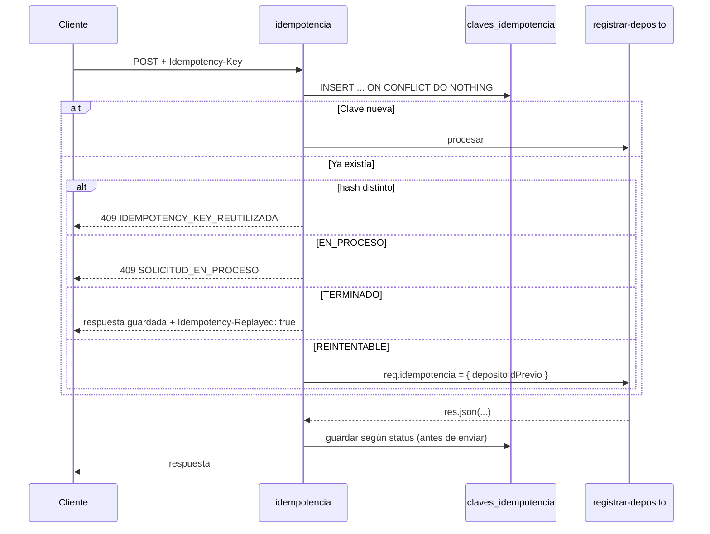

# SPEC-05 · Idempotencia

## 1. Metadatos y Tech Stack

**Objetivo:** Que un reintento del cliente nunca acredite dos veces, aunque la respuesta original se haya perdido o billetera no haya respondido a tiempo.

- **Tipo:** transversal, solo en `POST /api/v1/depositos`.
- **Depende de:** SPEC-01 (tabla `depositos`), SPEC-03 (`req.usuario`).
- **Versión spec:** 1.1

**Stack:** Express 4.21, pg 8.13, `node:crypto`. Pruebas: Jest 29 + Supertest 7 + nock 13.

## 2. Archivos Involucrados

El Agente tiene permitido leer y modificar ÚNICAMENTE los siguientes archivos:

- [NUEVO] `src/core/middlewares/idempotencia.js` (Reserva la clave, repite respuestas y guarda el resultado).
- [NUEVO] `src/core/repositories/idempotenciaRepository.js` (`reservar`, `buscar`, `tomarReintento`, `terminar`, `marcarReintentable`, `borrar`, `borrarAntiguas`).
- [NUEVO] `src/core/tareas/limpiarClaves.js` (Exporta `iniciar()`: cada hora llama a `borrarAntiguas(IDEMPOTENCIA_DIAS)`).
- [NUEVO] `db/05-idempotencia.sql`
- [NUEVO] `tests/integration/idempotencia/idempotencia.test.js`

## 3. Flujo del Sistema



## 4. Reglas de Negocio

- **IDE-R01** · Header `Idempotency-Key` obligatorio, de 8 a 100 caracteres. Si falta o no cumple → 400 `IDEMPOTENCY_KEY_REQUERIDA`.
- **IDE-R02** · La clave es única **por usuario**: PK `(usuario_id, clave)`.
- **IDE-R03** · `hash_solicitud` = SHA-256 (hex) de `método + ' ' + req.originalUrl + ' ' + body`, con el body serializado con las llaves ordenadas alfabéticamente.
- **IDE-R04** · La reserva es atómica: `INSERT ... ON CONFLICT DO NOTHING`. Nunca "SELECT y luego INSERT".
- **IDE-R05** · Si la clave existía, se aplica el `alt` del diagrama en ese orden (primero se compara el hash).
- **IDE-R06** · `REINTENTABLE`: `UPDATE ... SET estado='EN_PROCESO' WHERE usuario_id=$1 AND clave=$2 AND estado='REINTENTABLE'`. Si actualiza 0 filas (otra petición ganó) → 409 `SOLICITUD_EN_PROCESO`. Si actualiza → `req.idempotencia = { depositoIdPrevio: deposito_id }` y continúa.
- **IDE-R07** · Al repetir una respuesta `TERMINADO`: mismo status y cuerpo guardados, header `Idempotency-Replayed: true`, header `X-Correlation-Id` de la petición **actual**, y `res.locals.depositoId = deposito_id` para la auditoría.
- **IDE-R08** · Se sobrescribe `res.json` para guardar **antes** de enviar:
  - status < 500 → `TERMINADO` con status, cuerpo y `deposito_id` = `res.locals.depositoId`.
  - status 502 con `res.locals.depositoId` (falló la acreditación) → `REINTENTABLE` con ese `deposito_id`.
  - cualquier otro 5xx → se borra la clave.
  - Si el guardado falla → `logger.error` y la respuesta se envía igual.
- **IDE-R09** · Las claves con más de `IDEMPOTENCIA_DIAS` se borran cada hora, en cualquier estado.
- **IDE-R10** · Riesgo conocido, fuera de alcance: si el proceso se cae con una clave `EN_PROCESO`, esa clave responde 409 hasta que se borre.

```sql
CREATE TABLE claves_idempotencia (
    usuario_id      VARCHAR(50)  NOT NULL,
    clave           VARCHAR(100) NOT NULL,
    hash_solicitud  CHAR(64)     NOT NULL,
    estado          VARCHAR(20)  NOT NULL CHECK (estado IN ('EN_PROCESO','TERMINADO','REINTENTABLE')),
    status_http     SMALLINT,
    respuesta       JSONB,
    deposito_id     UUID REFERENCES depositos(id),
    creado_en       TIMESTAMPTZ  NOT NULL DEFAULT now(),
    PRIMARY KEY (usuario_id, clave)
);
CREATE INDEX idx_claves_creado ON claves_idempotencia (creado_en);
```

## 5. El Contrato (API Contract)

- **Header de entrada:** `Idempotency-Key: <8 a 100 caracteres>` (obligatorio en `POST /api/v1/depositos`).
- **Header de salida:** `Idempotency-Replayed: true` (solo al repetir una respuesta guardada).

**Response HTTP 409**
```json
{ "codigo": "SOLICITUD_EN_PROCESO", "mensaje": "La solicitud original con esa clave aún se procesa.", "correlationId": "abc-123" }
```

## 6. Instrucciones de Ejecución para el Agente

1. **`desarrolladorback`:** Crear los archivos de §2. El middleware va en la ruta POST, después de `requiereRol` (SPEC-07).
2. **`desarrolladorfront`:** Reglas de la clave en SPEC-07 §6.
3. **`tester`:** IDE-T01 e IDE-T09 se prueban con una app mínima; el resto requiere SPEC-07.
   - **IDE-T01** · POST con clave nueva → pasa; fila `TERMINADO` con el status de la respuesta.
   - **IDE-T02** · Repetir el mismo POST → mismo status y cuerpo, `Idempotency-Replayed: true`, billetera llamada 1 vez.
   - **IDE-T03** · Misma clave, monto distinto → 409 `IDEMPOTENCY_KEY_REUTILIZADA`.
   - **IDE-T04** · Billetera tarda 2 s; segundo POST a los 100 ms → 409 `SOLICITUD_EN_PROCESO`.
   - **IDE-T05** · 5 POST simultáneos con la misma clave → 1 depósito, 1 acreditación.
   - **IDE-T06** · Billetera 500 al acreditar, luego reintento y billetera OK → 502, luego 201 con el **mismo** `id`; billetera recibió el mismo `depositoId`.
   - **IDE-T07** · Billetera timeout, luego reintento y billetera 409 → 201 COMPLETADO.
   - **IDE-T08** · Billetera 500 al **consultar** la cuenta, luego reintento → 502, luego se procesa como nuevo.
   - **IDE-T09** · Sin header, y con clave de 7 caracteres → 400 `IDEMPOTENCY_KEY_REQUERIDA`.
   - **IDE-T10** · `usr-agente-1` y `usr-agente-2` con la misma clave → ambos se procesan.
4. **`revisor`:** Verificar IDE-R04, IDE-R06 y IDE-R08.

**Criterios de aceptación:**
- ✅ Ningún reintento produce dos acreditaciones.
- ✅ Tras un fallo de billetera, reintentar con la misma clave completa el mismo depósito.
