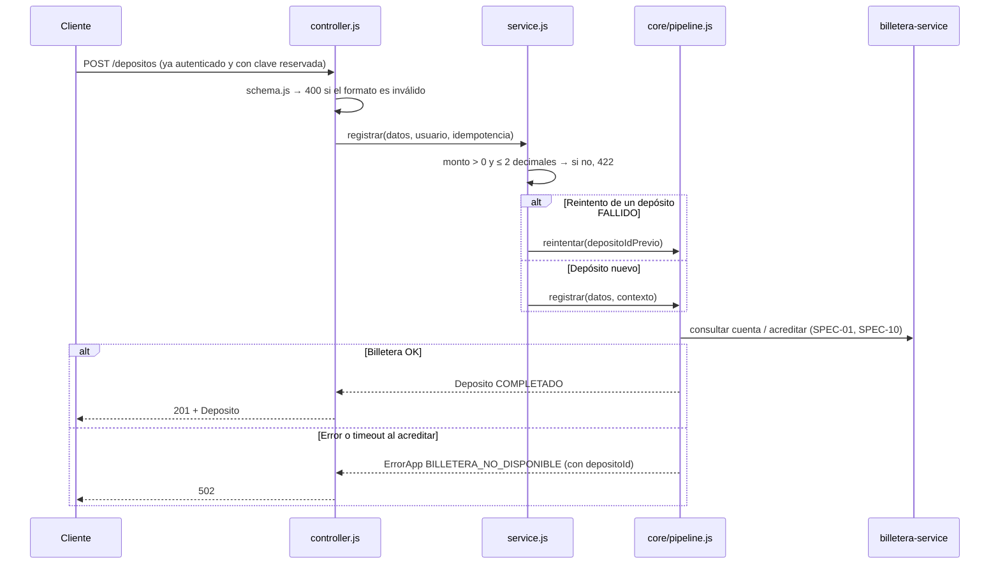

# SPEC-05 · registrar-deposito

## 1. Metadatos y Tech Stack

**Objetivo:** Registrar un depósito a una cuenta de billetera-service y pedir su acreditación, ejecutando el pipeline del core para que las extensiones se enchufen sin modificar este módulo.

| Campo | Valor |
|---|---|
| Id | `registrar-deposito` |
| Tipo | endpoint |
| Ruta | `POST /api/v1/depositos` |
| Depende de | SPEC-01 (pipeline), SPEC-02, SPEC-03, SPEC-04, SPEC-10 (billetera) |
| Lo extienden | SPEC-07 limites-por-canal, SPEC-08 conversion-moneda, SPEC-09 alerta-uif |
| Versión spec | 1.0 |

**Backend Stack:** Express 4.21, zod 3.23, decimal.js 10.4. **Pruebas:** Jest 29 + Supertest 7 + nock 13.

## 2. Archivos Involucrados

El Agente tiene permitido leer y modificar ÚNICAMENTE los siguientes archivos:

- [NUEVO] `src/modules/registrar-deposito/index.js` (`{ id, tipo: 'endpoint', router }`).
- [NUEVO] `src/modules/registrar-deposito/routes.js` (`POST /depositos` con `requiereRol('CLIENTE','AGENTE','CAJERO')` → `idempotencia` → controller).
- [NUEVO] `src/modules/registrar-deposito/schema.js` (Validación de formato con zod → 400).
- [NUEVO] `src/modules/registrar-deposito/controller.js` (Llama al service, asigna `res.locals.depositoId`, responde 201).
- [NUEVO] `src/modules/registrar-deposito/service.js` (Reglas RD-R03 + llama a `pipeline.registrar` o `pipeline.reintentar`).
- [SOLO LEER] `src/core/pipeline.js`, `src/core/errores.js`, `src/core/middlewares/*`.
- [NUEVO] `tests/unit/registrar-deposito.test.js` · `tests/integration/registrar-deposito.test.js`

No tiene `repository.js`: el depósito lo guarda el pipeline del core.

## 3. Flujo del Sistema



## 4. Reglas de Negocio

| Id | Regla |
|---|---|
| RD-R01 | Obligatorios: `cuentaDestino`, `monto`, `moneda`, `canal`. Faltante, tipo incorrecto o campo desconocido → 400 `FORMATO_INVALIDO`. |
| RD-R02 | Formato: `cuentaDestino` con `^\d{4}-\d{4}-\d{6}$`; `monto` **string** con `^-?\d+(\.\d+)?$`; `moneda` en PEN \| USD; `canal` en AGENTE \| VENTANILLA \| APP; `referencia` opcional, máx. 140. |
| RD-R03 | Valor: `monto` ≤ 0 o con más de 2 decimales → 422 `MONTO_INVALIDO`. Se convierte a `Decimal` de inmediato. |
| RD-R04 | La cuenta debe existir (si no, 422 `CUENTA_NO_ENCONTRADA`) y estar `ACTIVA` (si no, 422 `CUENTA_INACTIVA`). Lo hace el pipeline. |
| RD-R05 | El canal debe corresponder al rol y un CLIENTE solo deposita a cuentas propias (SEG-R09, SEG-R10) → 403. |
| RD-R06 | Se acredita `montoAcreditar` en `monedaAcreditar`. Si difiere de la moneda de la cuenta → 422 `MONEDA_NO_SOPORTADA`. |
| RD-R07 | Si llega `req.idempotencia.depositoIdPrevio`, no se crea un depósito nuevo: se llama a `pipeline.reintentar`. |
| RD-R08 | Este módulo no menciona ni importa limites, conversión ni UIF. |

## 5. El Contrato (API Contract)

**Ruta:** `POST /api/v1/depositos` · **Content-Type:** `application/json`
**Headers:** `Authorization: Bearer <jwt>`, `Idempotency-Key`, `X-Correlation-Id` (opcional).

**Request**
```json
{ "cuentaDestino": "0011-0123-456789", "monto": "150.00", "moneda": "PEN", "canal": "AGENTE", "referencia": "Pago alquiler" }
```

**Response HTTP 201** (objeto `Deposito` de SPEC-01; header `Idempotency-Replayed: true` si es repetición)
```json
{
  "id": "7f1c2e9a-0b1d-4c5e-9f00-123456789abc", "cuentaDestino": "0011-0123-456789",
  "monto": "150.00", "moneda": "PEN", "canal": "AGENTE", "referencia": "Pago alquiler",
  "estado": "COMPLETADO", "creadoEn": "2026-10-13T19:20:00Z", "actualizadoEn": "2026-10-13T19:20:01Z",
  "extensiones": {}
}
```

**Response HTTP 422**
```json
{ "codigo": "MONTO_INVALIDO", "mensaje": "El monto debe ser mayor a 0 y tener hasta 2 decimales.", "correlationId": "abc-123" }
```

| HTTP | Códigos posibles |
|---|---|
| 400 | `FORMATO_INVALIDO`, `IDEMPOTENCY_KEY_REQUERIDA` |
| 401 / 403 | Ver SPEC-02 |
| 409 | `IDEMPOTENCY_KEY_REUTILIZADA`, `SOLICITUD_EN_PROCESO` |
| 422 | `MONTO_INVALIDO`, `CUENTA_NO_ENCONTRADA`, `CUENTA_INACTIVA`, `MONEDA_NO_SOPORTADA` + los de extensiones activas |
| 502 | `BILLETERA_NO_DISPONIBLE` |

## 6. Instrucciones de Ejecución para el Agente

1. **`desarrolladorback`:** Crear los archivos de §2 cumpliendo §4 y §5.
2. **`desarrolladorfront`:** Pantalla **Nuevo depósito**. Cuenta con máscara `0000-0000-000000`; monto con 2 decimales enviado como string; canal fijo según el rol. Generar la `Idempotency-Key` al abrir la pantalla; en error de red o 502 mostrar "Reintentar" con la **misma** clave. En 201 mostrar comprobante con cuenta enmascarada y los bloques de `extensiones` que vengan. Mensajes:

| Código | Mensaje |
|---|---|
| `MONTO_INVALIDO` | El monto debe ser mayor a 0 y tener hasta 2 decimales |
| `CUENTA_NO_ENCONTRADA` / `CUENTA_INACTIVA` | La cuenta no existe / La cuenta no está activa |
| `MONEDA_NO_SOPORTADA` | No se puede depositar en esa moneda a esta cuenta |
| `BILLETERA_NO_DISPONIBLE` | No se pudo completar. Intente de nuevo |
| `SOLICITUD_EN_PROCESO` | Su depósito se está procesando, espere un momento |
| Otro | Ocurrió un error. Código de seguimiento: {correlationId} |

3. **`tester`:** Billetera mockeada con nock según SPEC-10. Crear estas pruebas:

| Id | Caso | Esperado |
|---|---|---|
| RD-T01 | AGENTE, `"150.00"` PEN, canal AGENTE, cuenta PEN activa | 201 COMPLETADO; 1 fila; billetera recibió `"150.00"` y el `depositoId` |
| RD-T02 | monto `"0"`, `"-1"`, `"10.001"` | 422 `MONTO_INVALIDO`; 0 filas; billetera no llamada |
| RD-T03 | monto `"0.01"` | 201 |
| RD-T04 | Sin `cuentaDestino` / monto como número `150` | 400 `FORMATO_INVALIDO` |
| RD-T05 | Billetera 404 al consultar | 422 `CUENTA_NO_ENCONTRADA` |
| RD-T06 | Cuenta `BLOQUEADA` | 422 `CUENTA_INACTIVA` |
| RD-T07 | Billetera 500 al acreditar | 502; depósito FALLIDO |
| RD-T08 | Billetera tarda 6 s al acreditar | 502; depósito FALLIDO |
| RD-T09 | Billetera 500 al consultar | 502; 0 filas |
| RD-T10 | conversion-moneda inactiva, USD a cuenta PEN | 422 `MONEDA_NO_SOPORTADA` |
| RD-T11 | Todas las extensiones inactivas | 201; `extensiones` = `{}` |
| RD-T12 | Flujo exitoso (spy del repository) | Pasa por PENDIENTE y PROCESANDO antes de COMPLETADO |

4. **`revisor`:** Verificar RD-R03 (Decimal, nunca Number) y RD-R08.

**Criterios de aceptación:**
- ✅ Un depósito válido queda COMPLETADO y billetera recibe una sola acreditación.
- ✅ Un monto inválido no crea filas ni llama a billetera.
- ✅ Si billetera falla, el depósito queda FALLIDO, el cliente recibe 502 y puede reintentar.
- ✅ Con todas las extensiones inactivas, el depósito funciona igual.
