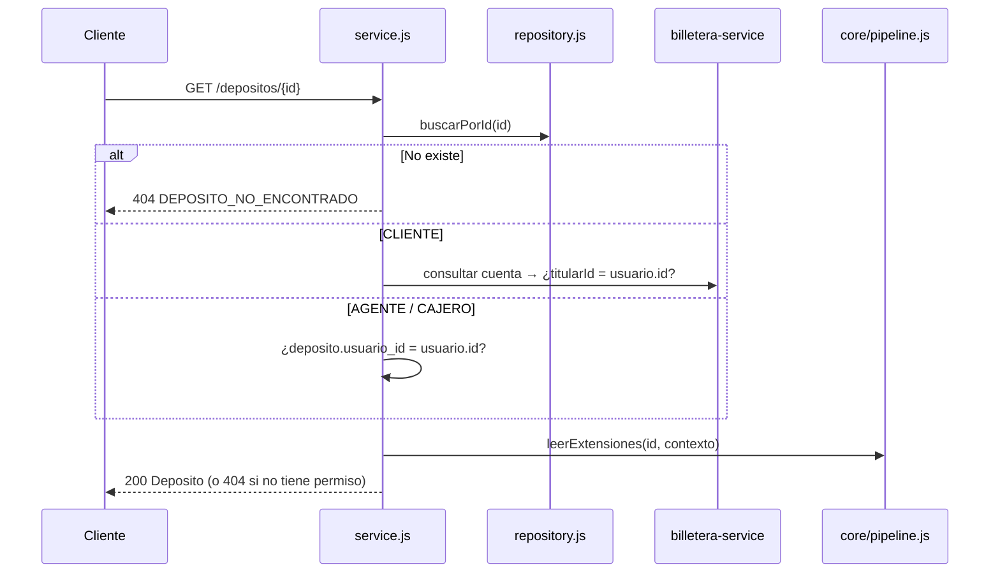

# SPEC-06 · consultar-depositos

## 1. Metadatos y Tech Stack

**Objetivo:** Consultar un depósito por su id (con los datos de las extensiones activas) y listar el historial paginado de una cuenta, respetando lo que cada rol puede ver.

| Campo | Valor |
|---|---|
| Id | `consultar-depositos` |
| Tipo | endpoint |
| Rutas | `GET /api/v1/depositos/{id}` · `GET /api/v1/cuentas/{numero}/depositos` |
| Depende de | SPEC-01 (`leerExtensiones`), SPEC-02 (`esTitular`), SPEC-03, SPEC-10 (consultar cuenta) |
| Versión spec | 1.0 |

**Backend Stack:** Express 4.21, zod 3.23, pg 8.13. **Pruebas:** Jest 29 + Supertest 7 + nock 13.

## 2. Archivos Involucrados

El Agente tiene permitido leer y modificar ÚNICAMENTE los siguientes archivos:

- [NUEVO] `src/modules/consultar-depositos/index.js` (`{ id, tipo: 'endpoint', router }`).
- [NUEVO] `src/modules/consultar-depositos/routes.js` (Las 2 rutas con `requiereRol('CLIENTE','AGENTE','CAJERO')`).
- [NUEVO] `src/modules/consultar-depositos/schema.js` (Validación de `id`, `numero` y query → 400).
- [NUEVO] `src/modules/consultar-depositos/controller.js`
- [NUEVO] `src/modules/consultar-depositos/service.js` (Permisos por rol + arma la respuesta).
- [NUEVO] `src/modules/consultar-depositos/repository.js` (Solo SELECT sobre `depositos`).
- [SOLO LEER] `src/core/pipeline.js`, `src/core/permisos.js`, `src/core/clients/billeteraClient.js`.
- [NUEVO] `tests/integration/consultar-depositos.test.js`

## 3. Flujo del Sistema



## 4. Reglas de Negocio

**Consultar uno** (`GET /depositos/{id}`)

| Id | Regla |
|---|---|
| CON-R01 | `id` debe ser UUID; si no → 400 `FORMATO_INVALIDO`. |
| CON-R02 | CLIENTE solo ve depósitos de cuentas propias (`esTitular` con la cuenta de billetera). |
| CON-R03 | AGENTE y CAJERO solo ven depósitos que ellos registraron (`usuario_id`). |
| CON-R04 | Sin permiso → 404 `DEPOSITO_NO_ENCONTRADO` (no 403), para no revelar que existe. |
| CON-R05 | `extensiones` = resultado de `pipeline.leerExtensiones`. Este módulo no sabe qué features existen. |

**Historial** (`GET /cuentas/{numero}/depositos`)

| Id | Regla |
|---|---|
| CON-R06 | Query: `pagina` ≥ 1 (def. 1), `tamano` 1–100 (def. 20), `estado` opcional, `desde`/`hasta` ISO opcionales. Fuera de rango o `desde` > `hasta` → 400. |
| CON-R07 | CLIENTE: si la cuenta no es suya → 403 `SIN_PERMISO`. AGENTE/CAJERO: solo sus depósitos en esa cuenta, sin llamar a billetera. |
| CON-R08 | Orden `creado_en` descendente. `total` se calcula con los mismos filtros. |
| CON-R09 | La lista no incluye `extensiones` (es liviana); el detalle se ve con la otra ruta. |
| CON-R10 | Si billetera falla al verificar al CLIENTE → 502 `BILLETERA_NO_DISPONIBLE`. |

## 5. El Contrato (API Contract)

**Ruta 1:** `GET /api/v1/depositos/{id}` · **Response HTTP 200:** objeto `Deposito` de SPEC-01, con `extensiones`.
```json
{ "id": "7f1c2e9a-...", "cuentaDestino": "0011-0123-456789", "monto": "100.00", "moneda": "USD",
  "canal": "APP", "referencia": null, "estado": "COMPLETADO", "creadoEn": "...", "actualizadoEn": "...",
  "extensiones": { "conversion-moneda": { "monedaCuenta": "PEN", "tipoCambio": "3.7500", "montoAcreditado": "375.00" } } }
```

**Ruta 2:** `GET /api/v1/cuentas/{numero}/depositos?pagina=1&tamano=20&estado=COMPLETADO&desde=...&hasta=...`
**Response HTTP 200**
```json
{ "datos": [ { "id": "...", "cuentaDestino": "0011-0123-456789", "monto": "150.00", "moneda": "PEN",
  "canal": "AGENTE", "referencia": "Pago alquiler", "estado": "COMPLETADO", "creadoEn": "...", "actualizadoEn": "..." } ],
  "pagina": 1, "tamano": 20, "total": 1 }
```

| HTTP | Códigos posibles |
|---|---|
| 400 | `FORMATO_INVALIDO` |
| 401 / 403 | Ver SPEC-02 (403 solo en el historial) |
| 404 | `DEPOSITO_NO_ENCONTRADO` |
| 502 | `BILLETERA_NO_DISPONIBLE` |

## 6. Instrucciones de Ejecución para el Agente

1. **`desarrolladorback`:** Crear los archivos de §2. LIMIT y OFFSET con parámetros. Asignar `res.locals.depositoId` en la ruta 1.
2. **`desarrolladorfront`:** **Detalle del depósito**: cuenta enmascarada, estado con color (en curso / éxito / error), botón "Actualizar" si está PENDIENTE o PROCESANDO, un bloque por cada clave de `extensiones`; 404 → "No encontramos este depósito". **Mis depósitos** (CLIENTE) o **Depósitos registrados** (AGENTE/CAJERO): tabla con fecha, monto, moneda, canal, estado y referencia; filtros por estado y fechas; páginas de 20; lista vacía → "Aún no hay depósitos en esta cuenta".
3. **`tester`:** Crear estas pruebas:

| Id | Caso | Esperado |
|---|---|---|
| CON-T01 | CLIENTE consulta depósito de su cuenta | 200 con todos los campos |
| CON-T02 | UUID inexistente / id `abc` | 404 `DEPOSITO_NO_ENCONTRADO` / 400 `FORMATO_INVALIDO` |
| CON-T03 | CLIENTE consulta depósito de otra cuenta | 404 |
| CON-T04 | AGENTE consulta depósito de otro agente | 404 |
| CON-T05 | Depósito USD→PEN con conversion-moneda activa / inactiva | `extensiones` con / sin `conversion-moneda` |
| CON-T06 | Historial: 3 depósitos | 200, 3 elementos, el más reciente primero |
| CON-T07 | Historial: cuenta sin depósitos | `datos: []`, `total: 0` |
| CON-T08 | 25 depósitos, `pagina=2&tamano=20` | 5 elementos, `total: 25` |
| CON-T09 | `estado=FALLIDO` | Solo FALLIDOS |
| CON-T10 | CLIENTE con cuenta ajena | 403 `SIN_PERMISO` |
| CON-T11 | `tamano=500` | 400 `FORMATO_INVALIDO` |
| CON-T12 | AGENTE pide historial | Solo depósitos con su `usuario_id`; billetera no llamada |

4. **`revisor`:** Verificar CON-R04, CON-R05 y que el repository solo hace SELECT.

**Criterios de aceptación:**
- ✅ Nadie ve depósitos que no le corresponden según su rol.
- ✅ Activar o desactivar una extensión cambia `extensiones` sin tocar este módulo.
