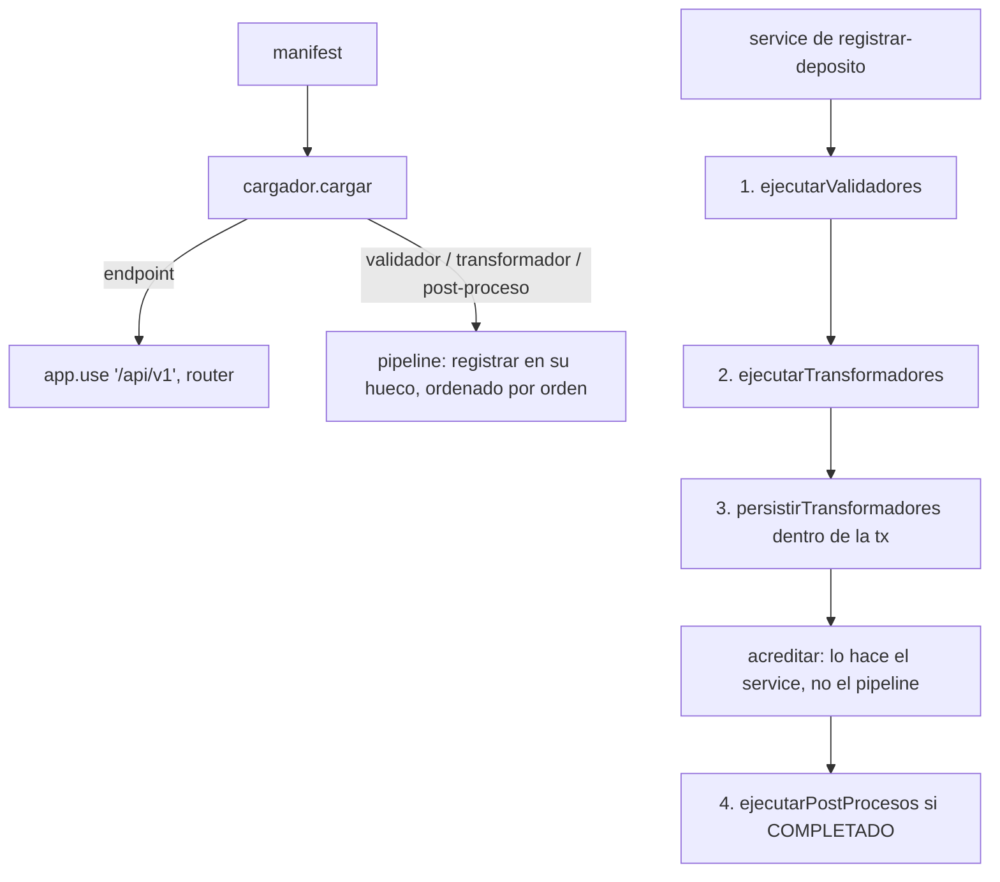

# SPEC-06 · Pipeline, cargador y app

## 1. Metadatos y Tech Stack

**Objetivo:** Definir los huecos donde se enchufan las features, el contrato exacto que cumple cada módulo, y cómo el cargador arma la app según el manifest, sin que agregar o quitar una feature modifique el core.

- **Depende de:** SPEC-01, SPEC-03, SPEC-04 (middlewares globales).
- **Lo usan:** SPEC-07 a SPEC-12.
- **Versión spec:** 1.1

**Stack:** Express 4.21, js-yaml 4.1. Pruebas: Jest 29 + Supertest 7.

## 2. Archivos Involucrados

El Agente tiene permitido leer y modificar ÚNICAMENTE los siguientes archivos:

- [NUEVO] `src/core/pipeline.js` (Ejecuta los huecos. No conoce ninguna feature por su nombre).
- [NUEVO] `src/core/cargador.js` (`cargar(manifest)`: valida y registra los módulos activos).
- [NUEVO] `src/app.js` (Exporta `crearApp({ manifest })`, que devuelve la app Express sin hacer `listen`).
- [NUEVO] `src/server.js` (Lee el YAML de `MANIFEST_PATH`, llama a `crearApp`, a `limpiarClaves.iniciar()` y hace `listen(PORT)`).
- [NUEVO] `tests/core/pipeline.test.js` · `tests/core/cargador.test.js` (Con módulos falsos, no con las features reales).

## 3. Flujo del Sistema



## 4. Reglas de Negocio

**Objetos que reciben los módulos de extensión**

```js
deposito = {
  id,               // UUID ya generado por el service; en validadores y transformadores aún NO está en la BD
  cuentaDestino,    // string
  monto,            // Decimal (decimal.js)
  moneda,           // 'PEN' | 'USD'
  canal,            // 'AGENTE' | 'VENTANILLA' | 'APP'
  referencia,       // string | null
  usuarioId,        // string
  montoAcreditar,   // Decimal; inicia igual a monto
  monedaAcreditar,  // inicia igual a moneda
  extensiones: {},  // datos visibles para el cliente, uno por id de módulo
  estado,           // solo en post-procesos: 'COMPLETADO'
};
contexto = {
  usuario,          // { id, roles }
  cuenta,           // { numero, estado, moneda, titularId }; null en un reintento
  correlationId,
  logger,           // logger.child({ correlationId, modulo: id })
  db,               // pool de src/core/db.js
  privado,          // objeto propio del módulo, nunca sale en la respuesta; se conserva de ejecutar a persistir
};
```

**Contrato de un módulo** (`src/modules/<id>/index.js`)

- Endpoint: `{ id, tipo: 'endpoint', router }`. El router define rutas relativas (`/depositos`) y la app lo monta en `/api/v1`.
- Extensión: `{ id, tipo, ejecutar, errores?, persistir?, leerExtension? }`.
  - `ejecutar(deposito, contexto)`: el validador no devuelve nada o lanza `ErrorApp`; el transformador devuelve el `deposito`; el post-proceso no devuelve nada.
  - `errores`: `{ CODIGO: { status, mensaje } }`. Un validador solo declara status 422.
  - `persistir(deposito, tx, contexto)`: solo transformadores. `tx` es la transacción del INSERT del depósito.
  - `leerExtension(depositoId, contexto)`: devuelve un objeto o `null`.
  - Los repositories de los módulos reciben el ejecutor (`contexto.db` o `tx`) como primer parámetro.

**Pipeline**
- **PIP-R01** · `ejecutarValidadores(deposito, contexto)`: en orden ascendente; el primero que lanza corta y el error se propaga tal cual.
- **PIP-R02** · `ejecutarTransformadores(deposito, contexto)`: en cadena, cada uno recibe lo que devolvió el anterior. Si uno lanza → se propaga como 500 `ERROR_INTERNO`.
- **PIP-R03** · `persistirTransformadores(deposito, tx, contexto)`: llama a `persistir` de cada transformador que lo tenga. Si uno lanza, se propaga (el service hace rollback).
- **PIP-R04** · `ejecutarPostProcesos(deposito, contexto)`: cada uno en `try/catch`; un error se registra con `logger.error` (con `depositoId`) y se sigue con el siguiente. Nunca lanza.
- **PIP-R05** · `leerExtensiones(depositoId, contexto)`: llama a `leerExtension` de cada extensión activa que lo tenga. Devuelve `{ [id]: objeto }` y omite los `null`.
- **PIP-R06** · Si un hueco está vacío, la función no hace nada.
- **PIP-R07** · Cada módulo recibe su propio `contexto.privado` (`contexto.privado` es distinto por id) y el mismo objeto se pasa a su `persistir`.

**Cargador y app**
- **PIP-R08** · `cargar(manifest)` solo hace `require` de las features con `estado: activo`. El `orden` sale del manifest.
- **PIP-R09** · Si una feature activa no existe en `src/modules/`, o su `tipo` no coincide con el del manifest → lanza error y la app no arranca.
- **PIP-R10** · Registra los `errores` de cada módulo con `registrarErrores` (SPEC-01).
- **PIP-R11** · `crearApp({ manifest })` monta en este orden: `trust proxy` = `TRUST_PROXY` → `correlationId` → `auditoria` → `GET /health` → `autenticar` → `express.json({ limit: '100kb' })` → routers en `/api/v1` → 404 `RUTA_NO_ENCONTRADA` → `manejadorErrores`.
- **PIP-R12** · `crearApp` no inicia tareas; `server.js` llama a `limpiarClaves.iniciar()` (SPEC-05).

## 5. El Contrato (API Contract)

No agrega rutas de negocio. Rutas inexistentes:

**Response HTTP 404**
```json
{ "codigo": "RUTA_NO_ENCONTRADA", "mensaje": "La ruta no existe.", "correlationId": "abc-123" }
```

## 6. Instrucciones de Ejecución para el Agente

1. **`desarrolladorback`:** Crear los archivos de §2.
2. **`tester`:** Usar módulos falsos en `tests/core/fixtures/` y un manifest como objeto.
   - **PIP-T01** · Manifest sin extensiones → los 4 huecos no hacen nada.
   - **PIP-T02** · Validadores con orden 20 y 10 → corre primero el de orden 10.
   - **PIP-T03** · Un validador lanza → el siguiente validador no corre; el error llega intacto.
   - **PIP-T04** · Dos transformadores → el segundo recibe lo que devolvió el primero.
   - **PIP-T05** · Post-proceso que lanza → no se propaga; `logger.error` con `depositoId`; el siguiente post-proceso corre.
   - **PIP-T06** · `leerExtensiones` con un módulo que devuelve `null` → su clave no aparece.
   - **PIP-T07** · Feature activa inexistente → `cargar` lanza.
   - **PIP-T08** · Feature con `tipo` distinto al del manifest → `cargar` lanza.
   - **PIP-T09** · Feature `inactivo` → no se hace `require` de su carpeta.
   - **PIP-T10** · Ruta inexistente con token → 404 `RUTA_NO_ENCONTRADA`.
3. **`revisor`:** Verificar que `pipeline.js` y `cargador.js` no nombran ninguna feature, y PIP-R11.

**Criterios de aceptación:**
- ✅ Activar o desactivar una feature en el manifest cambia el comportamiento sin tocar `src/core/`.
- ✅ Las pruebas pueden armar la app con cualquier combinación de features.
