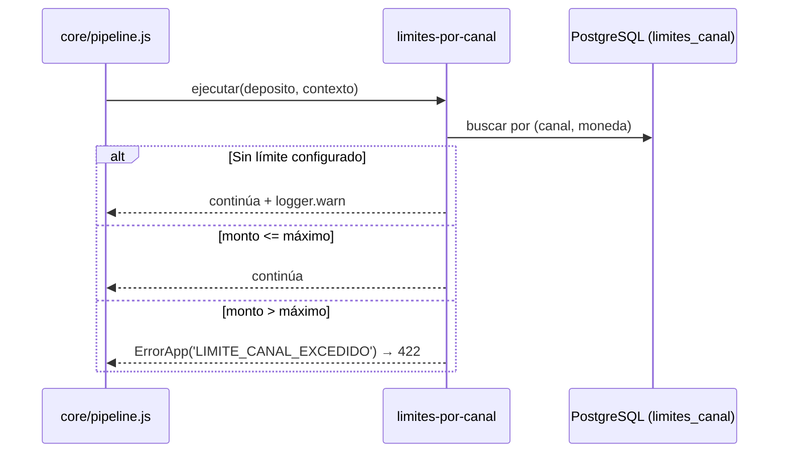

# SPEC-07 · limites-por-canal

## 1. Metadatos y Tech Stack

**Objetivo:** Rechazar un depósito si su monto supera el máximo permitido para su canal y moneda. Ej.: un agente (bodega) no maneja tanto efectivo como una ventanilla.

| Campo | Valor |
|---|---|
| Id | `limites-por-canal` |
| Tipo | validador · extiende SPEC-05 · orden en el manifest |
| Depende de | SPEC-01 (contrato de extensión) |
| Versión spec | 1.0 |

**Stack:** pg 8.13, decimal.js 10.4. **Pruebas:** Jest 29 + Supertest 7.

## 2. Archivos Involucrados

El Agente tiene permitido leer y modificar ÚNICAMENTE los siguientes archivos:

- [NUEVO] `src/modules/limites-por-canal/index.js` (`{ id, tipo, errores, ejecutar }`).
- [NUEVO] `src/modules/limites-por-canal/repository.js` (Lee `limites_canal`).
- [NUEVO] `db/07-limites-canal.sql` (Tabla + datos de ejemplo).
- [NUEVO] `tests/unit/limites-por-canal.test.js` · `tests/integration/limites-por-canal.test.js`
- [SOLO LEER] `src/core/errores.js`.

## 3. Flujo del Sistema



## 4. Reglas de Negocio

| Id | Regla |
|---|---|
| LC-R01 | El límite se busca por canal y moneda **del depósito** (antes de cualquier conversión). |
| LC-R02 | monto > `monto_maximo` → 422 `LIMITE_CANAL_EXCEDIDO`. Monto igual al límite → se permite. |
| LC-R03 | Sin límite configurado para ese canal y moneda → se permite y se escribe una advertencia en el log. |
| LC-R04 | Se compara con `Decimal`, nunca con `Number`. Los límites viven en la tabla, nunca en el código. |
| LC-R05 | Solo lee: no modifica el depósito. |

```sql
CREATE TABLE limites_canal (
    canal         VARCHAR(20)   NOT NULL,
    moneda        CHAR(3)       NOT NULL,
    monto_maximo  NUMERIC(15,2) NOT NULL CHECK (monto_maximo > 0),
    PRIMARY KEY (canal, moneda)
);
-- Valores de EJEMPLO [POR ACORDAR]: el equipo debe definir los reales.
INSERT INTO limites_canal VALUES
  ('AGENTE','PEN',2000.00), ('AGENTE','USD',500.00),
  ('APP','PEN',5000.00), ('APP','USD',1500.00),
  ('VENTANILLA','PEN',50000.00), ('VENTANILLA','USD',15000.00);
```

## 5. El Contrato (API Contract)

No agrega rutas. Solo agrega un error posible a `POST /api/v1/depositos` (SPEC-05), declarado en `errores`:

**Response HTTP 422**
```json
{ "codigo": "LIMITE_CANAL_EXCEDIDO", "mensaje": "El monto supera el máximo permitido para el canal.", "correlationId": "abc-123" }
```

## 6. Instrucciones de Ejecución para el Agente

1. **`desarrolladorback`:** Crear el módulo cumpliendo el contrato de extensión de SPEC-01. No tocar `src/core/`.
2. **`desarrolladorfront`:** Ante `LIMITE_CANAL_EXCEDIDO` mostrar "El monto supera el máximo permitido para este canal". No validar el límite en el front.
3. **`tester`:** Crear estas pruebas, con el id en el nombre:

| Id | Caso | Esperado |
|---|---|---|
| LC-T01 | AGENTE 1500.00 PEN | Continúa |
| LC-T02 | AGENTE 2000.00 PEN | Continúa (igual al límite) |
| LC-T03 | AGENTE 2000.01 PEN (integración) | 422; 0 filas en `depositos`; billetera no llamada |
| LC-T04 | Canal sin fila en la tabla | Continúa; `logger.warn` llamado |
| LC-T05 | Feature `inactivo` en el manifest, AGENTE 2500.00 PEN | 201 |

4. **`revisor`:** Verificar LC-R04 y LC-R05.

**Criterios de aceptación:**
- ✅ Un depósito sobre el límite se rechaza sin guardar nada ni llamar a billetera.
- ✅ Cambiar un límite en la tabla cambia el comportamiento sin tocar código.
- ✅ Desactivar la feature en el manifest la quita sin romper nada.
