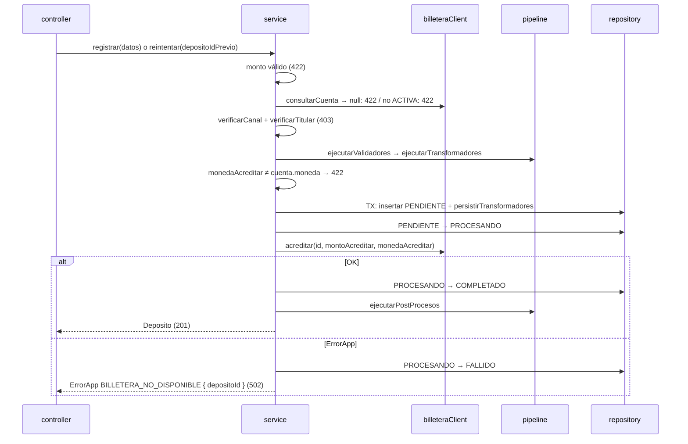

# SPEC-07 · registrar-deposito

## 1. Metadatos y Tech Stack

**Objetivo:** Registrar un depósito a una cuenta de billetera-service y pedir su acreditación, pasando por los huecos del pipeline para que las extensiones se enchufen sin modificar este módulo.

- **Id:** `registrar-deposito` · **Tipo:** endpoint · **Ruta:** `POST /api/v1/depositos`
- **Depende de:** SPEC-01, 02 (billetera), 03 (permisos), 04, 05, 06 (pipeline).
- **Lo extienden:** SPEC-10 limites-por-canal, SPEC-11 conversion-moneda, SPEC-12 alerta-uif.
- **Versión spec:** 1.1

**Stack:** Express 4.21, zod 3.23, decimal.js 10.4, pg 8.13. Pruebas: Jest 29 + Supertest 7 + nock 13.

## 2. Archivos Involucrados

El Agente tiene permitido leer y modificar ÚNICAMENTE los siguientes archivos:

- [NUEVO] `src/modules/registrar-deposito/index.js` (`{ id, tipo: 'endpoint', router }`).
- [NUEVO] `src/modules/registrar-deposito/routes.js` (`POST /depositos`: `requiereRol('CLIENTE','AGENTE','CAJERO')` → `idempotencia` → controller).
- [NUEVO] `src/modules/registrar-deposito/schema.js` (zod, modo estricto → 400).
- [NUEVO] `src/modules/registrar-deposito/controller.js` (Valida con schema, llama al service, asigna `res.locals.depositoId`, responde 201).
- [NUEVO] `src/modules/registrar-deposito/service.js` (`registrar(datos, usuario, correlationId)` y `reintentar(depositoId, usuario, correlationId)`).
- [NUEVO] `src/modules/registrar-deposito/repository.js` (`insertar(tx, deposito)`, `buscarPorId(db, id)`, `cambiarEstado(db, id, de, a)`).
- [NUEVO] `tests/unit/registrar-deposito/service.test.js` · `tests/integration/registrar-deposito/registrar.test.js`

## 3. Flujo del Sistema



## 4. Reglas de Negocio

- **RD-R01** · Body estricto. Obligatorios: `cuentaDestino`, `monto`, `moneda`, `canal`. Faltante, tipo incorrecto o campo desconocido → 400 `FORMATO_INVALIDO`.
- **RD-R02** · Formato: `cuentaDestino` `^\d{4}-\d{4}-\d{6}$` · `monto` **string** `^-?\d{1,13}(\.\d+)?$` · `moneda` PEN | USD · `canal` AGENTE | VENTANILLA | APP · `referencia` string opcional de 1 a 140.
- **RD-R03** · Valor: `monto` ≤ 0 o con más de 2 decimales → 422 `MONTO_INVALIDO`. Se convierte a `Decimal` de inmediato.
- **RD-R04** · Orden exacto del service = el diagrama. Nada se guarda antes del paso "TX".
- **RD-R05** · El objeto `deposito` y el `contexto` se arman como define SPEC-06 §4, con `id = crypto.randomUUID()`.
- **RD-R06** · `cambiarEstado(db, id, de, a)` hace `UPDATE ... SET estado=a, actualizado_en=now() WHERE id=$1 AND estado=de`. Si afecta 0 filas → lanza error (500). Solo transiciones de SPEC-01.
- **RD-R07** · Si el INSERT o un `persistir` falla → rollback, no se llama a billetera, 500.
- **RD-R08** · `reintentar(depositoId)`: lee el depósito. Si está COMPLETADO → lo devuelve (201). Si está FALLIDO → `FALLIDO → PROCESANDO` y acredita `monto_acreditar` y `moneda_acreditar` guardados, sin consultar la cuenta ni repetir validadores ni transformadores; luego sigue igual que el `alt` del diagrama (post-procesos con `contexto.cuenta = null`). Otro estado → 409 `SOLICITUD_EN_PROCESO`.
- **RD-R09** · La respuesta 201 es `aJson(fila, deposito.extensiones)` (SPEC-01). En un reintento, `extensiones` = `pipeline.leerExtensiones`.
- **RD-R10** · Este módulo no menciona ni importa limites, conversión ni UIF.

## 5. El Contrato (API Contract)

**Ruta:** `POST /api/v1/depositos` · **Content-Type:** `application/json`
**Headers:** `Authorization: Bearer <jwt>`, `Idempotency-Key`, `X-Correlation-Id` (opcional).

**Request**
```json
{ "cuentaDestino": "0011-0123-456789", "monto": "150.00", "moneda": "PEN", "canal": "AGENTE", "referencia": "Pago alquiler" }
```

**Response HTTP 201** (objeto `Deposito` de SPEC-01; `Idempotency-Replayed: true` si es repetición)
```json
{ "id": "7f1c2e9a-0b1d-4c5e-9f00-123456789abc", "cuentaDestino": "0011-0123-456789", "monto": "150.00",
  "moneda": "PEN", "canal": "AGENTE", "referencia": "Pago alquiler", "estado": "COMPLETADO",
  "creadoEn": "2026-10-13T19:20:00.000Z", "actualizadoEn": "2026-10-13T19:20:01.000Z", "extensiones": {} }
```

**Errores posibles:** 400 `FORMATO_INVALIDO`, `IDEMPOTENCY_KEY_REQUERIDA` · 401 (SPEC-03) · 403 `SIN_PERMISO` · 409 `IDEMPOTENCY_KEY_REUTILIZADA`, `SOLICITUD_EN_PROCESO` · 422 `MONTO_INVALIDO`, `CUENTA_NO_ENCONTRADA`, `CUENTA_INACTIVA`, `MONEDA_NO_SOPORTADA` + los de extensiones activas · 502 `BILLETERA_NO_DISPONIBLE`.

## 6. Instrucciones de Ejecución para el Agente

1. **`desarrolladorback`:** Crear los archivos de §2 cumpliendo §4 y §5.
2. **`desarrolladorfront`:** Pantalla **Nuevo depósito** (CLIENTE, AGENTE, CAJERO).
   - Cuenta con máscara `0000-0000-000000`; monto con 2 decimales enviado como string; canal fijo según el rol; referencia hasta 140.
   - Clave: generar un UUID al abrir la pantalla. Error de red o 502 → botón "Reintentar" con la **misma** clave. Cualquier 4xx → al corregir y reenviar, **clave nueva**.
   - 201 → comprobante con id, monto, moneda, cuenta enmascarada, fecha, estado y cada bloque de `extensiones`.
   - Mensajes: `MONTO_INVALIDO` "El monto debe ser mayor a 0 y tener hasta 2 decimales" · `CUENTA_NO_ENCONTRADA` "La cuenta no existe" · `CUENTA_INACTIVA` "La cuenta no está activa" · `MONEDA_NO_SOPORTADA` "No se puede depositar en esa moneda a esta cuenta" · `SIN_PERMISO` "No tiene permiso para depositar a esta cuenta" · `BILLETERA_NO_DISPONIBLE` "No se pudo completar. Intente de nuevo" · `SOLICITUD_EN_PROCESO` "Su depósito se está procesando, espere un momento" · otro "Ocurrió un error. Código de seguimiento: {correlationId}".
3. **`tester`:** Usuarios y cuentas de SPEC-02; todas las extensiones inactivas salvo que el caso diga otra cosa.
   - **RD-T01** · `usr-agente-1`, `"150.00"` PEN, AGENTE, a `0011-0123-456789` → 201 COMPLETADO; 1 fila; billetera recibió `"150.00"` y el `depositoId`.
   - **RD-T02** · monto `"0"`, `"-1"`, `"10.001"` → 422 `MONTO_INVALIDO`; 0 filas; billetera no llamada.
   - **RD-T03** · monto `"0.01"` → 201.
   - **RD-T04** · Sin `cuentaDestino`; monto como número `150`; campo extra `"x": 1` → 400 `FORMATO_INVALIDO`.
   - **RD-T05** · Billetera 404 al consultar → 422 `CUENTA_NO_ENCONTRADA`.
   - **RD-T06** · `0011-0123-000003` (BLOQUEADA) → 422 `CUENTA_INACTIVA`.
   - **RD-T07** · Billetera 500 al acreditar → 502; depósito FALLIDO.
   - **RD-T08** · Billetera tarda 6 s al acreditar → 502; depósito FALLIDO.
   - **RD-T09** · Billetera 500 al consultar → 502; 0 filas.
   - **RD-T10** · `"100.00"` USD a `0011-0123-456789` (PEN) → 422 `MONEDA_NO_SOPORTADA`.
   - **RD-T11** · Flujo exitoso con spy de `cambiarEstado` → PENDIENTE→PROCESANDO, PROCESANDO→COMPLETADO.
   - **RD-T12** · `reintentar` de un depósito FALLIDO con billetera OK → mismo `id`, COMPLETADO, sin nueva consulta de cuenta.
4. **`revisor`:** Verificar RD-R03 (Decimal, nunca Number), RD-R04, RD-R06 y RD-R10.

**Criterios de aceptación:**
- ✅ Un depósito válido queda COMPLETADO y billetera recibe una sola acreditación.
- ✅ Un monto inválido no crea filas ni llama a billetera.
- ✅ Si billetera falla, el depósito queda FALLIDO, el cliente recibe 502 y puede reintentar.
- ✅ Con todas las extensiones inactivas, el depósito funciona igual.
