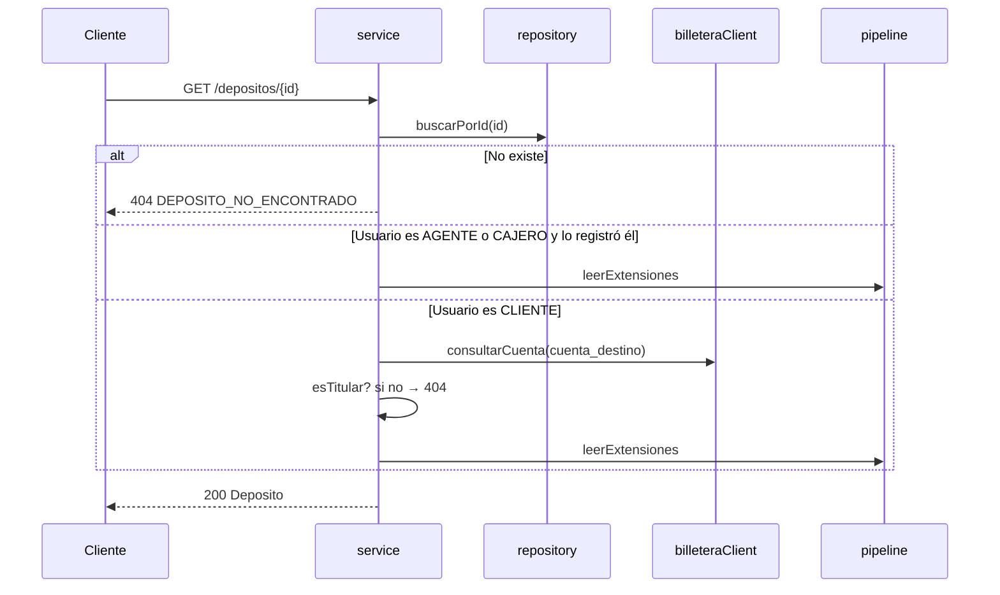

# SPEC-08 · consultar-deposito

## 1. Metadatos y Tech Stack

**Objetivo:** Devolver un depósito por su id, con su estado actual y los datos de las extensiones activas, solo a quien tiene permiso de verlo.

- **Id:** `consultar-deposito` · **Tipo:** endpoint · **Ruta:** `GET /api/v1/depositos/{id}`
- **Depende de:** SPEC-01 (`aJson`), 02 (billetera), 03 (`esTitular`), 04, 06 (`leerExtensiones`).
- **Versión spec:** 1.1

**Stack:** Express 4.21, zod 3.23, pg 8.13. Pruebas: Jest 29 + Supertest 7 + nock 13.

## 2. Archivos Involucrados

El Agente tiene permitido leer y modificar ÚNICAMENTE los siguientes archivos:

- [NUEVO] `src/modules/consultar-deposito/index.js` (`{ id, tipo: 'endpoint', router }`).
- [NUEVO] `src/modules/consultar-deposito/routes.js` (`GET /depositos/:id` con `requiereRol('CLIENTE','AGENTE','CAJERO')`).
- [NUEVO] `src/modules/consultar-deposito/controller.js` (Valida `id`, llama al service, asigna `res.locals.depositoId`, responde 200).
- [NUEVO] `src/modules/consultar-deposito/service.js` (`consultar(id, usuario, correlationId)`).
- [NUEVO] `src/modules/consultar-deposito/repository.js` (`buscarPorId(db, id)`. Solo SELECT sobre `depositos`).
- [NUEVO] `tests/integration/consultar-deposito/consultar.test.js`

## 3. Flujo del Sistema



## 4. Reglas de Negocio

- **CD-R01** · `id` debe ser UUID; si no → 400 `FORMATO_INVALIDO`.
- **CD-R02** · Puede verlo si se cumple **alguna**: el usuario tiene rol AGENTE o CAJERO y `deposito.usuario_id === usuario.id`; o el usuario tiene rol CLIENTE y `esTitular(usuario, cuenta)`.
- **CD-R03** · Solo se consulta a billetera si hace falta (rol CLIENTE y no se cumplió la primera condición).
- **CD-R04** · Billetera devuelve `null` (cuenta inexistente) → se trata como "no es titular".
- **CD-R05** · Sin permiso → 404 `DEPOSITO_NO_ENCONTRADO` (no 403), para no revelar que existe.
- **CD-R06** · Billetera falla al verificar → 502 `BILLETERA_NO_DISPONIBLE`.
- **CD-R07** · Respuesta = `aJson(fila, await pipeline.leerExtensiones(id, contexto))`. Este módulo no sabe qué features existen.

## 5. El Contrato (API Contract)

**Ruta:** `GET /api/v1/depositos/{id}` · **Headers:** `Authorization: Bearer <jwt>`, `X-Correlation-Id` (opcional).

**Response HTTP 200** (objeto `Deposito` de SPEC-01)
```json
{ "id": "7f1c2e9a-0b1d-4c5e-9f00-123456789abc", "cuentaDestino": "0011-0123-456789", "monto": "100.00",
  "moneda": "USD", "canal": "APP", "referencia": null, "estado": "COMPLETADO",
  "creadoEn": "2026-10-13T19:20:00.000Z", "actualizadoEn": "2026-10-13T19:20:01.000Z",
  "extensiones": { "conversion-moneda": { "monedaCuenta": "PEN", "tipoCambio": "3.7500", "montoAcreditado": "375.00" } } }
```

**Response HTTP 404**
```json
{ "codigo": "DEPOSITO_NO_ENCONTRADO", "mensaje": "No existe un depósito con ese id.", "correlationId": "abc-123" }
```

**Errores posibles:** 400 `FORMATO_INVALIDO` · 401 / 403 (SPEC-03, solo por rol) · 404 `DEPOSITO_NO_ENCONTRADO` · 502 `BILLETERA_NO_DISPONIBLE`.

## 6. Instrucciones de Ejecución para el Agente

1. **`desarrolladorback`:** Crear los archivos de §2.
2. **`desarrolladorfront`:** Pantalla **Detalle del depósito** (se abre desde el comprobante o el historial).
   - Mostrar id, cuenta enmascarada, monto, moneda, canal, referencia, estado y fechas.
   - Estado con color: PENDIENTE y PROCESANDO "en curso", COMPLETADO "éxito", FALLIDO "error".
   - Si está PENDIENTE o PROCESANDO, botón "Actualizar".
   - Un bloque por cada clave de `extensiones`; si no viene, nada.
   - 404 → "No encontramos este depósito".
3. **`tester`:** Crear los depósitos directo en la BD con los usuarios y cuentas de SPEC-02.
   - **CD-T01** · `usr-cliente-1` consulta un depósito a `0011-0123-456789` → 200 con todos los campos.
   - **CD-T02** · UUID inexistente → 404 `DEPOSITO_NO_ENCONTRADO`.
   - **CD-T03** · id `abc` → 400 `FORMATO_INVALIDO`.
   - **CD-T04** · `usr-cliente-2` consulta un depósito a `0011-0123-456789` → 404.
   - **CD-T05** · `usr-agente-2` consulta un depósito registrado por `usr-agente-1` → 404; billetera no llamada.
   - **CD-T06** · `usr-agente-1` consulta su propio depósito → 200; billetera no llamada.
   - **CD-T07** · Depósito con fila en `conversiones_deposito`, conversion-moneda activa → `extensiones.conversion-moneda` presente.
   - **CD-T08** · El mismo depósito con conversion-moneda inactiva → `extensiones` sin esa clave.
   - **CD-T09** · `usr-cliente-1` y billetera 500 → 502 `BILLETERA_NO_DISPONIBLE`.
4. **`revisor`:** Verificar CD-R05, CD-R07 y que el repository solo hace SELECT.

**Criterios de aceptación:**
- ✅ Nadie ve un depósito que no le corresponde, ni puede saber que existe.
- ✅ Activar o desactivar una extensión cambia `extensiones` sin tocar este módulo.
