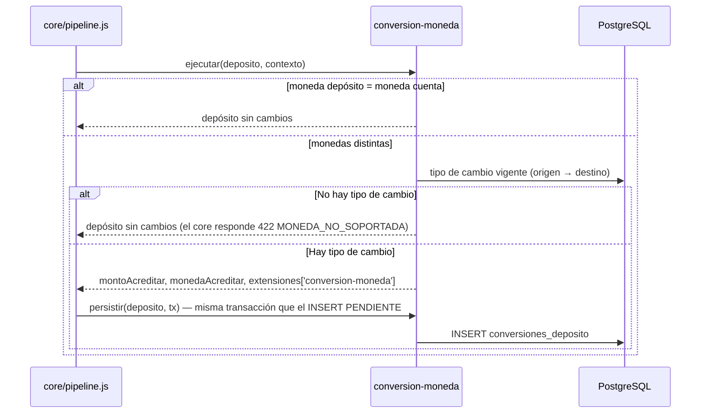

# SPEC-08 · conversion-moneda

## 1. Metadatos y Tech Stack

**Objetivo:** Si el depósito llega en una moneda distinta a la de la cuenta (PEN ↔ USD), calcular cuánto acreditar en la moneda de la cuenta según el tipo de cambio vigente.

| Campo | Valor |
|---|---|
| Id | `conversion-moneda` |
| Tipo | transformador · extiende SPEC-05 · orden en el manifest |
| Depende de | SPEC-01 (contrato de extensión: `ejecutar`, `persistir`, `leerExtension`) |
| Versión spec | 1.0 |

**Stack:** pg 8.13, decimal.js 10.4. **Pruebas:** Jest 29 + Supertest 7 + nock 13.

## 2. Archivos Involucrados

El Agente tiene permitido leer y modificar ÚNICAMENTE los siguientes archivos:

- [NUEVO] `src/modules/conversion-moneda/index.js` (`{ id, tipo, ejecutar, persistir, leerExtension }`).
- [NUEVO] `src/modules/conversion-moneda/service.js` (Cálculo con Decimal).
- [NUEVO] `src/modules/conversion-moneda/repository.js` (Lee `tipos_cambio`; escribe y lee `conversiones_deposito`).
- [NUEVO] `db/08-conversion-moneda.sql`
- [NUEVO] `tests/unit/conversion-moneda.test.js` · `tests/integration/conversion-moneda.test.js`

## 3. Flujo del Sistema



## 4. Reglas de Negocio

| Id | Regla |
|---|---|
| CM-R01 | Si la moneda del depósito = moneda de la cuenta (`contexto.cuenta.moneda`) → no hace nada. |
| CM-R02 | Si son distintas, usa la fila de `tipos_cambio` con ese par (origen → destino) y la `vigente_desde` más reciente que sea `<= now()`. |
| CM-R03 | Cada sentido tiene su propia fila: USD→PEN usa el tipo de compra del banco, PEN→USD el de venta. |
| CM-R04 | `montoAcreditar = monto × valor`, redondeado a 2 decimales con `ROUND_HALF_UP`. Todo con Decimal. |
| CM-R05 | Asigna `deposito.montoAcreditar`, `deposito.monedaAcreditar`, `deposito.extensiones['conversion-moneda']` y guarda `tipoCambioId` en `contexto.privado`. |
| CM-R06 | Sin tipo de cambio para el par → no modifica nada y no lanza error; el core rechaza con 422 `MONEDA_NO_SOPORTADA`. |
| CM-R07 | `persistir` inserta en `conversiones_deposito` usando la `tx` que recibe (misma transacción que el depósito). |
| CM-R08 | Si billetera falla después, la fila de conversión se queda: pertenece al depósito FALLIDO. |
| CM-R09 | Fuente de los tipos de cambio: [POR ACORDAR]. Por ahora carga manual en la tabla. |

```sql
CREATE TABLE tipos_cambio (
    id              UUID PRIMARY KEY,
    moneda_origen   CHAR(3)        NOT NULL,
    moneda_destino  CHAR(3)        NOT NULL,
    valor           NUMERIC(10,4)  NOT NULL CHECK (valor > 0),
    vigente_desde   TIMESTAMPTZ    NOT NULL
);
CREATE INDEX idx_tipos_cambio_par ON tipos_cambio (moneda_origen, moneda_destino, vigente_desde DESC);

CREATE TABLE conversiones_deposito (
    deposito_id     UUID PRIMARY KEY REFERENCES depositos(id),
    tipo_cambio_id  UUID           NOT NULL REFERENCES tipos_cambio(id),
    moneda_cuenta   CHAR(3)        NOT NULL,
    tipo_cambio     NUMERIC(10,4)  NOT NULL,
    monto_final     NUMERIC(15,2)  NOT NULL
);
```

## 5. El Contrato (API Contract)

No agrega rutas. Agrega este bloque a las respuestas de `POST /api/v1/depositos` (SPEC-05) y `GET /api/v1/depositos/{id}` (SPEC-06), **solo si hubo conversión**:

```json
"extensiones": {
  "conversion-moneda": { "monedaCuenta": "PEN", "tipoCambio": "3.7500", "montoAcreditado": "375.00" }
}
```

A billetera se le envía `montoAcreditar` y `monedaAcreditar` (ej. `"375.00"` PEN), no el monto original.

## 6. Instrucciones de Ejecución para el Agente

1. **`desarrolladorback`:** Crear el módulo cumpliendo el contrato de extensión de SPEC-01. No tocar `src/core/`.
2. **`desarrolladorfront`:** Si viene `extensiones.conversion-moneda`, mostrar en el comprobante y en el detalle: "Se acreditaron S/ 375.00 (tipo de cambio 3.7500)". No calcular la conversión en el front.
3. **`tester`:** Crear estas pruebas, con el id en el nombre:

| Id | Caso | Esperado |
|---|---|---|
| CM-T01 | 100.00 USD a cuenta PEN, tipo 3.7500 | Billetera recibe `"375.00"` PEN; fila con `monto_final` 375.00 |
| CM-T02 | 150.00 PEN a cuenta PEN | Sin fila; sin clave en `extensiones` |
| CM-T03 | USD a cuenta PEN sin tipo cargado | 422 `MONEDA_NO_SOPORTADA` |
| CM-T04 | Tipos de ayer (3.70) y de hoy (3.75) | Usa 3.75 |
| CM-T05 | Tipo con `vigente_desde` mañana | Se ignora |
| CM-T06 | 10.01 × 3.7555 | 37.59 |
| CM-T07 | Feature inactiva, USD a cuenta PEN | 422 `MONEDA_NO_SOPORTADA` |
| CM-T08 | Billetera falla después de convertir | Depósito FALLIDO; la fila de conversión se queda |
| CM-T09 | `GET /depositos/{id}` de un depósito convertido | `extensiones.conversion-moneda` presente |

4. **`revisor`:** Verificar CM-R04 (Decimal y redondeo) y CM-R07 (usa la `tx` recibida).

**Criterios de aceptación:**
- ✅ Un depósito en otra moneda se acredita convertido con el tipo de cambio vigente.
- ✅ La conversión queda registrada y se puede ver en el detalle del depósito.
- ✅ Sin la feature, un depósito en otra moneda se rechaza con 422.
