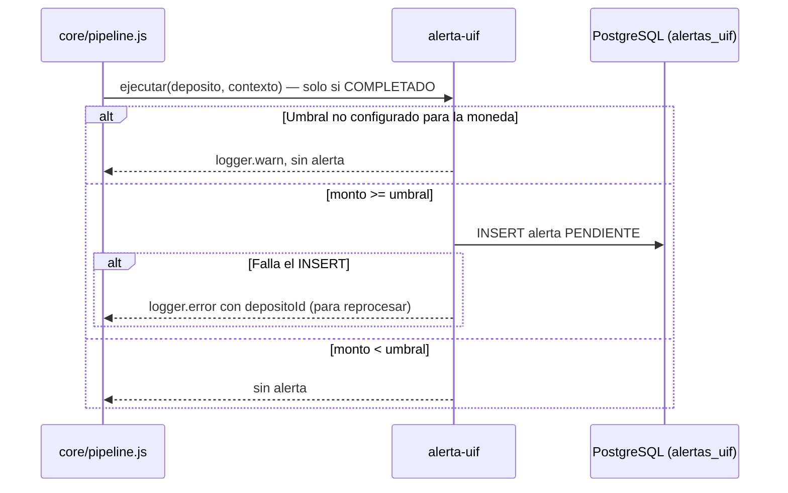

# SPEC-09 · alerta-uif

## 1. Metadatos y Tech Stack

**Objetivo:** Marcar los depósitos que igualan o superan el umbral de la normativa antilavado, para que el área de cumplimiento los revise y, si corresponde, los reporte a la UIF-Perú (SBS). Nunca bloquea el depósito.

| Campo | Valor |
|---|---|
| Id | `alerta-uif` |
| Tipo | post-proceso · extiende SPEC-05 · orden en el manifest |
| Depende de | SPEC-01 (contrato de extensión) |
| Versión spec | 1.0 |

**Stack:** pg 8.13, decimal.js 10.4. **Pruebas:** Jest 29 + Supertest 7 + nock 13.

## 2. Archivos Involucrados

El Agente tiene permitido leer y modificar ÚNICAMENTE los siguientes archivos:

- [NUEVO] `src/modules/alerta-uif/index.js` (`{ id, tipo, ejecutar }`. Sin `leerExtension`).
- [NUEVO] `src/modules/alerta-uif/repository.js` (INSERT en `alertas_uif`).
- [NUEVO] `db/09-alerta-uif.sql`
- [NUEVO] `tests/unit/alerta-uif.test.js` · `tests/integration/alerta-uif.test.js`
- [SOLO LEER] `src/config.js` (umbrales).

## 3. Flujo del Sistema



## 4. Reglas de Negocio

| Id | Regla |
|---|---|
| UIF-R01 | Solo corre cuando el depósito quedó COMPLETADO (también tras un reintento exitoso). |
| UIF-R02 | Compara el monto **depositado**, en su moneda original (no el monto convertido). |
| UIF-R03 | Si monto >= umbral de esa moneda → inserta una fila en `alertas_uif` con `estado_reporte` PENDIENTE. Comparación con Decimal. |
| UIF-R04 | Umbrales en `UIF_UMBRAL_PEN` y `UIF_UMBRAL_USD`. **El valor real debe verificarse en la normativa SBS vigente** [POR ACORDAR]; nunca en el código. Si falta el de una moneda → advertencia en el log y no hay alerta. |
| UIF-R05 | Nunca cambia el estado del depósito ni la respuesta. Nunca se muestra a ningún rol (no tiene `leerExtension`). |
| UIF-R06 | Si falla al guardar, escribe `logger.error` con el `depositoId` para reprocesar; el depósito sigue COMPLETADO. |
| UIF-R07 | `estado_reporte` puede cambiar después (PENDIENTE → REPORTADO o DESCARTADO); por eso no va en la tabla de auditoría, que es inmutable. |
| UIF-R08 | Fuera de alcance: detectar fraccionamiento (varios depósitos pequeños que suman el umbral) y la pantalla de cumplimiento. |

```sql
CREATE TABLE alertas_uif (
    id              UUID PRIMARY KEY,
    deposito_id     UUID          NOT NULL UNIQUE REFERENCES depositos(id),
    monto           NUMERIC(15,2) NOT NULL,
    moneda          CHAR(3)       NOT NULL,
    umbral          NUMERIC(15,2) NOT NULL,
    estado_reporte  VARCHAR(20)   NOT NULL DEFAULT 'PENDIENTE'
                    CHECK (estado_reporte IN ('PENDIENTE','REPORTADO','DESCARTADO')),
    creado_en       TIMESTAMPTZ   NOT NULL DEFAULT now()
);
```

## 5. El Contrato (API Contract)

No agrega rutas ni cambia ninguna respuesta. Es invisible para el cliente.

## 6. Instrucciones de Ejecución para el Agente

1. **`desarrolladorback`:** Crear el módulo cumpliendo el contrato de extensión de SPEC-01. No tocar `src/core/`.
2. **`desarrolladorfront`:** No aplica.
3. **`tester`:** Usar en pruebas `UIF_UMBRAL_PEN=1000.00`, nunca el valor real.

| Id | Caso | Esperado |
|---|---|---|
| UIF-T01 | COMPLETADO con 1000.00 PEN | 1 fila PENDIENTE con umbral 1000.00 |
| UIF-T02 | COMPLETADO con 999.99 PEN | 0 filas |
| UIF-T03 | FALLIDO con 5000.00 PEN | 0 filas |
| UIF-T04 | Forzar error en el INSERT | 201 normal; `logger.error` con `depositoId` |
| UIF-T05 | `GET /depositos/{id}` como CLIENTE | Sin datos de UIF |
| UIF-T06 | Feature inactiva, 5000.00 PEN | 201; 0 filas |
| UIF-T07 | Sin `UIF_UMBRAL_USD`, 9000.00 USD por VENTANILLA a cuenta USD | 201; 0 filas; `logger.warn` |

4. **`revisor`:** Verificar UIF-R03 ("mayor o igual" con Decimal), UIF-R04 y UIF-R05.

**Criterios de aceptación:**
- ✅ Todo depósito completado sobre el umbral genera una alerta.
- ✅ La alerta nunca afecta al depósito ni la ve el cliente.
