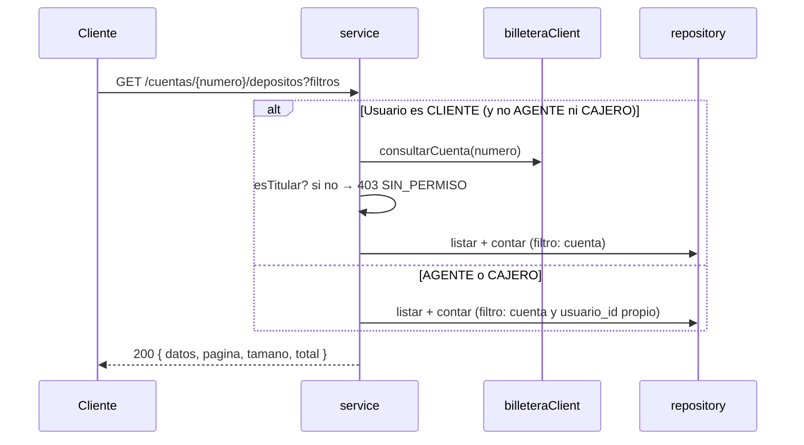

# SPEC-09 · historial-depositos

## 1. Metadatos y Tech Stack

**Objetivo:** Listar los depósitos de una cuenta, del más reciente al más antiguo, paginados y con filtros, según lo que cada rol puede ver.

- **Id:** `historial-depositos` · **Tipo:** endpoint · **Ruta:** `GET /api/v1/cuentas/{numero}/depositos`
- **Depende de:** SPEC-01 (`aJson`), 02 (billetera), 03 (`esTitular`), 04.
- **Versión spec:** 1.1

**Stack:** Express 4.21, zod 3.23, pg 8.13. Pruebas: Jest 29 + Supertest 7 + nock 13.

## 2. Archivos Involucrados

El Agente tiene permitido leer y modificar ÚNICAMENTE los siguientes archivos:

- [NUEVO] `src/modules/historial-depositos/index.js` (`{ id, tipo: 'endpoint', router }`).
- [NUEVO] `src/modules/historial-depositos/routes.js` (`GET /cuentas/:numero/depositos` con `requiereRol('CLIENTE','AGENTE','CAJERO')`).
- [NUEVO] `src/modules/historial-depositos/schema.js` (zod para `numero` y query → 400).
- [NUEVO] `src/modules/historial-depositos/controller.js`
- [NUEVO] `src/modules/historial-depositos/service.js` (`listar(numero, filtros, usuario, correlationId)`).
- [NUEVO] `src/modules/historial-depositos/repository.js` (`listar(db, filtros)` y `contar(db, filtros)`. Solo SELECT sobre `depositos`).
- [NUEVO] `tests/integration/historial-depositos/historial.test.js`

## 3. Flujo del Sistema



## 4. Reglas de Negocio

- **HD-R01** · `numero` con formato `^\d{4}-\d{4}-\d{6}$`; si no → 400 `FORMATO_INVALIDO`.
- **HD-R02** · Query: `pagina` entero ≥ 1 (def. 1) · `tamano` entero de 1 a 100 (def. 20) · `estado` uno de los 4 estados (opcional) · `desde` y `hasta` fecha-hora ISO 8601 (opcionales). Fuera de rango, formato inválido o `desde` > `hasta` → 400 `FORMATO_INVALIDO`.
- **HD-R03** · `desde` y `hasta` son inclusivos sobre `creado_en` (`>=` y `<=`).
- **HD-R04** · Si el usuario tiene rol AGENTE o CAJERO → solo depósitos con `usuario_id` propio en esa cuenta; no se llama a billetera.
- **HD-R05** · Si solo tiene rol CLIENTE → la cuenta debe ser suya (`esTitular`); si no, o si billetera devuelve `null` → 403 `SIN_PERMISO`. Si billetera falla → 502.
- **HD-R06** · Orden `creado_en DESC, id DESC`. `LIMIT` y `OFFSET` con parámetros.
- **HD-R07** · `total` se calcula con los mismos filtros que la lista.
- **HD-R08** · Cada elemento es `aJson(fila)` **sin** la clave `extensiones` (lista liviana; el detalle está en SPEC-08). No consulta tablas de extensiones.

## 5. El Contrato (API Contract)

**Ruta:** `GET /api/v1/cuentas/{numero}/depositos?pagina=1&tamano=20&estado=COMPLETADO&desde=2026-10-01T00:00:00Z&hasta=2026-10-31T23:59:59Z`

**Response HTTP 200**
```json
{ "datos": [ { "id": "7f1c2e9a-0b1d-4c5e-9f00-123456789abc", "cuentaDestino": "0011-0123-456789",
  "monto": "150.00", "moneda": "PEN", "canal": "AGENTE", "referencia": "Pago alquiler", "estado": "COMPLETADO",
  "creadoEn": "2026-10-13T19:20:00.000Z", "actualizadoEn": "2026-10-13T19:20:01.000Z" } ],
  "pagina": 1, "tamano": 20, "total": 1 }
```

**Response HTTP 403**
```json
{ "codigo": "SIN_PERMISO", "mensaje": "El rol o la cuenta no permiten la operación.", "correlationId": "abc-123" }
```

**Errores posibles:** 400 `FORMATO_INVALIDO` · 401 (SPEC-03) · 403 `SIN_PERMISO` · 502 `BILLETERA_NO_DISPONIBLE`.

## 6. Instrucciones de Ejecución para el Agente

1. **`desarrolladorback`:** Crear los archivos de §2.
2. **`desarrolladorfront`:** Pantalla **Mis depósitos** (CLIENTE) o **Depósitos registrados** (AGENTE / CAJERO).
   - Tabla: fecha, monto, moneda, canal, estado, referencia.
   - Filtros: estado y rango de fechas. Páginas de 20.
   - Tocar una fila abre el **Detalle del depósito** (SPEC-08).
   - Lista vacía → "Aún no hay depósitos en esta cuenta".
3. **`tester`:** Crear los depósitos directo en la BD con los usuarios y cuentas de SPEC-02.
   - **HD-T01** · `usr-cliente-1`, 3 depósitos en `0011-0123-456789` → 200, 3 elementos, el más reciente primero, sin `extensiones`.
   - **HD-T02** · Cuenta propia sin depósitos → `datos: []`, `total: 0`.
   - **HD-T03** · 25 depósitos, `pagina=2&tamano=20` → 5 elementos, `total: 25`.
   - **HD-T04** · `estado=FALLIDO` → solo FALLIDOS; `total` cuenta solo FALLIDOS.
   - **HD-T05** · `desde` igual al `creado_en` de un depósito → ese depósito se incluye.
   - **HD-T06** · `usr-cliente-2` pide `0011-0123-456789` → 403 `SIN_PERMISO`.
   - **HD-T07** · `tamano=500`, `pagina=0`, `desde` > `hasta` → 400 `FORMATO_INVALIDO`.
   - **HD-T08** · `usr-agente-1` con depósitos suyos y de `usr-agente-2` en la cuenta → solo los suyos; billetera no llamada.
4. **`revisor`:** Verificar HD-R06, HD-R07 y HD-R08.

**Criterios de aceptación:**
- ✅ Cada rol ve solo los depósitos que le corresponden.
- ✅ La paginación y los filtros devuelven siempre un `total` coherente con la lista.
