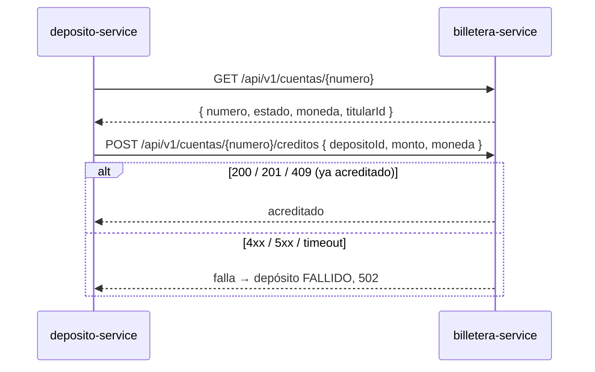

# SPEC-10 · Integraciones: billetera-service y usuario-service

## 1. Metadatos y Tech Stack

**Objetivo:** Definir el contrato que **proponemos** a los otros equipos y los mocks que lo respetan mientras se acuerda.

| Campo | Valor |
|---|---|
| Estado | **[POR ACORDAR]** con los equipos de billetera y de usuario |
| Lo usan | SPEC-01 (pipeline), SPEC-02 (JWT), SPEC-06 (titular de la cuenta) |
| Versión spec | 1.0 |

**Stack:** axios 1.7.9 (cliente HTTP), Express 4.21 (mock), jsonwebtoken 9.0.2. **Pruebas:** nock 13.5.

## 2. Archivos Involucrados

El Agente tiene permitido leer y modificar ÚNICAMENTE los siguientes archivos:

- [NUEVO] `src/core/clients/billeteraClient.js` (Único lugar que conoce `BILLETERA_URL`. Funciones `consultarCuenta`, `acreditar`).
- [NUEVO] `mocks/billetera/server.js` (Mock en memoria que respeta §5. Puerto 4000).
- [NUEVO] `mocks/billetera/Dockerfile`
- [NUEVO] `tests/helpers/billetera.js` (Helpers de nock: cuenta activa, 404, 500, demora, 409).
- [NUEVO] `scripts/generar-claves-dev.js` (Par RSA solo para desarrollo, en `.dev-keys/`, ignorado por git).
- [NUEVO] `scripts/generar-token.js` (Firma un token de prueba: `node scripts/generar-token.js CLIENTE usr-cliente-1`).
- [NUEVO] `tests/unit/billeteraClient.test.js`

## 3. Flujo del Sistema



## 4. Reglas de Negocio

| Id | Regla |
|---|---|
| INT-R01 | Solo HTTP. Nunca acceso a la base de datos de otro servicio. |
| INT-R02 | Toda llamada envía `Authorization: Bearer ${BILLETERA_TOKEN}` y `X-Correlation-Id`. El mecanismo real de autenticación entre servicios está [POR ACORDAR]. |
| INT-R03 | Timeout `BILLETERA_TIMEOUT_MS` (5000 por defecto) en ambas llamadas. |
| INT-R04 | Sin reintentos automáticos en `acreditar`. La protección contra doble acreditación es el `depositoId` (billetera lo usa como clave de idempotencia). |
| INT-R05 | `consultarCuenta`: 200 → devuelve la cuenta; 404 → devuelve `null`; 5xx o timeout → `ErrorApp('BILLETERA_NO_DISPONIBLE')`. |
| INT-R06 | `acreditar`: 200, 201 o 409 → acreditado; cualquier otro status o timeout → `ErrorApp('BILLETERA_NO_DISPONIBLE')`. |
| INT-R07 | El `monto` viaja como string con 2 decimales. |
| INT-R08 | El JWT de usuario-service se valida localmente (SPEC-02). Nunca se llama a usuario-service por petición. |
| INT-R09 | Cuentas del mock: `0011-0123-456789` ACTIVA PEN titular `usr-cliente-1`; `0011-0123-000002` ACTIVA USD titular `usr-cliente-2`; `0011-0123-000003` BLOQUEADA PEN; `0011-0123-999999` ACTIVA PEN que responde 500 al acreditar; `0011-0123-888888` ACTIVA PEN que tarda 6 s al acreditar. |
| INT-R10 | El mock recuerda los `depositoId` acreditados y responde 409 si se repiten. |

## 5. El Contrato (API Contract)

**billetera · Consultar cuenta:** `GET /api/v1/cuentas/{numero}`

**Response HTTP 200**
```json
{ "numero": "0011-0123-456789", "estado": "ACTIVA", "moneda": "PEN", "titularId": "usr-cliente-1" }
```

| Respuesta de billetera | Qué hace deposito-service |
|---|---|
| 200 con estado `ACTIVA` | Continúa |
| 200 con otro estado | 422 `CUENTA_INACTIVA` |
| 404 | 422 `CUENTA_NO_ENCONTRADA` |
| 5xx o timeout | 502 `BILLETERA_NO_DISPONIBLE` (no se guarda el depósito) |

**billetera · Acreditar:** `POST /api/v1/cuentas/{numero}/creditos`

**Request**
```json
{ "depositoId": "7f1c2e9a-0b1d-4c5e-9f00-123456789abc", "monto": "150.00", "moneda": "PEN", "concepto": "DEPOSITO" }
```

| Respuesta de billetera | Estado del depósito | Respuesta al cliente |
|---|---|---|
| 200 / 201 | COMPLETADO | 201 |
| 409 (ese `depositoId` ya se acreditó) | COMPLETADO | 201 |
| Otro 4xx, 5xx o timeout | FALLIDO | 502 `BILLETERA_NO_DISPONIBLE` |

**usuario · Payload propuesto del JWT** (firma RS256 [POR ACORDAR])
```json
{ "sub": "usr-cliente-1", "roles": ["CLIENTE"], "iss": "usuario-service", "aud": "banco-api", "exp": 1760000000 }
```

| Campo | Uso en deposito-service |
|---|---|
| `sub` | `usuario_id` en depósitos, idempotencia y auditoría |
| `roles` | CLIENTE, AGENTE o CAJERO (SPEC-02) |
| `iss` / `aud` / `exp` | Validación del token |

## 6. Instrucciones de Ejecución para el Agente

1. **`desarrolladorback`:** Crear el cliente, el mock y los scripts de §2. El mock no se usa en las pruebas automáticas (ahí se usa nock); es para probar a mano con `docker compose`.
2. **`tester`:** Crear estas pruebas del cliente con nock:

| Id | Caso | Esperado |
|---|---|---|
| INT-T01 | Consultar: 200 | Devuelve la cuenta |
| INT-T02 | Consultar: 404 | Devuelve `null` |
| INT-T03 | Consultar: 500 / timeout | `BILLETERA_NO_DISPONIBLE` |
| INT-T04 | Acreditar: 201 y 409 | Acreditado |
| INT-T05 | Acreditar: 400, 500, timeout | `BILLETERA_NO_DISPONIBLE`; 1 sola llamada (sin reintento) |
| INT-T06 | Cualquier llamada | Envía `Authorization` y `X-Correlation-Id` |

3. **`revisor`:** Verificar INT-R04 y que ninguna URL de billetera aparece fuera de `billeteraClient.js` y `.env.example`.

**Criterios de aceptación:**
- ✅ El servicio funciona de punta a punta con el mock mientras los otros equipos confirman.
- ✅ Cambiar al billetera-service real solo requiere cambiar `BILLETERA_URL` y `BILLETERA_TOKEN`.

**Preguntas abiertas para los otros equipos:** ver la tabla de pendientes en `README.md`.
