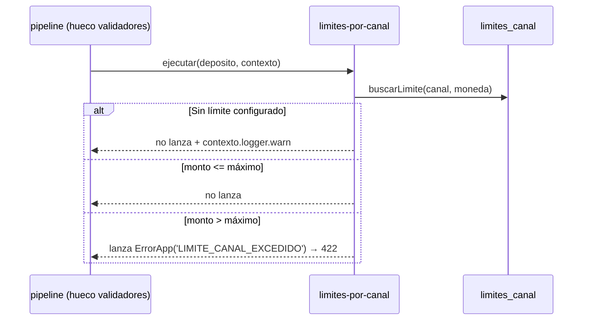

# SPEC-10 · limites-por-canal

## 1. Metadatos y Tech Stack

**Objetivo:** Rechazar un depósito si su monto supera el máximo permitido para su canal y moneda. Ej.: un agente (bodega) no maneja tanto efectivo como una ventanilla.

- **Id:** `limites-por-canal` · **Tipo:** validador · **Extiende:** SPEC-07 · **Orden:** en el manifest.
- **Depende de:** SPEC-06 (contrato de extensión).
- **Versión spec:** 1.1

**Stack:** pg 8.13, decimal.js 10.4. Pruebas: Jest 29 + Supertest 7 + nock 13.

## 2. Archivos Involucrados

El Agente tiene permitido leer y modificar ÚNICAMENTE los siguientes archivos:

- [NUEVO] `src/modules/limites-por-canal/index.js` (`{ id, tipo: 'validador', errores, ejecutar }`).
- [NUEVO] `src/modules/limites-por-canal/repository.js` (`buscarLimite(db, canal, moneda)` → `Decimal` o `null`).
- [NUEVO] `db/10-limites-canal.sql` (Tabla + datos de ejemplo).
- [NUEVO] `tests/unit/limites-por-canal/limites.test.js` · `tests/integration/limites-por-canal/limites.test.js`

## 3. Flujo del Sistema



## 4. Reglas de Negocio

- **LC-R01** · El límite se busca por `deposito.canal` y `deposito.moneda` (la moneda **del depósito**, antes de cualquier conversión).
- **LC-R02** · `deposito.monto` mayor que `monto_maximo` → lanza `ErrorApp('LIMITE_CANAL_EXCEDIDO')`. Igual al límite → se permite.
- **LC-R03** · Sin fila para ese canal y moneda → se permite y `contexto.logger.warn` con canal y moneda.
- **LC-R04** · Se compara con `Decimal` (`gt`), nunca con `Number`. Los límites viven en la tabla, nunca en el código.
- **LC-R05** · Solo lee: no modifica `deposito` ni devuelve nada.

```sql
CREATE TABLE limites_canal (
    canal         VARCHAR(20)   NOT NULL CHECK (canal IN ('AGENTE','VENTANILLA','APP')),
    moneda        CHAR(3)       NOT NULL CHECK (moneda IN ('PEN','USD')),
    monto_maximo  NUMERIC(15,2) NOT NULL CHECK (monto_maximo > 0),
    PRIMARY KEY (canal, moneda)
);
-- Valores de EJEMPLO [POR ACORDAR]: el equipo debe definir los reales.
INSERT INTO limites_canal VALUES
  ('AGENTE','PEN',2000.00), ('AGENTE','USD',500.00),
  ('APP','PEN',5000.00), ('APP','USD',1500.00),
  ('VENTANILLA','PEN',50000.00), ('VENTANILLA','USD',15000.00);
```

`limites_canal` es de configuración: `limpiar()` de las pruebas no la vacía.

## 5. El Contrato (API Contract)

No agrega rutas. Agrega un error posible a `POST /api/v1/depositos` (SPEC-07), declarado en `errores`:

- `LIMITE_CANAL_EXCEDIDO` · 422 · El monto supera el máximo permitido para el canal.

**Response HTTP 422**
```json
{ "codigo": "LIMITE_CANAL_EXCEDIDO", "mensaje": "El monto supera el máximo permitido para el canal.", "correlationId": "abc-123" }
```

## 6. Instrucciones de Ejecución para el Agente

1. **`desarrolladorback`:** Crear el módulo cumpliendo el contrato de SPEC-06. No tocar `src/core/`.
2. **`desarrolladorfront`:** Ante `LIMITE_CANAL_EXCEDIDO` mostrar "El monto supera el máximo permitido para este canal". No validar el límite en el front.
3. **`tester`:** Unitarias con la tabla de ejemplo; integración con `usr-agente-1`, canal AGENTE, cuenta `0011-0123-456789`.
   - **LC-T01** · AGENTE `1500.00` PEN → no lanza.
   - **LC-T02** · AGENTE `2000.00` PEN → no lanza (igual al límite).
   - **LC-T03** · AGENTE `2000.01` PEN → lanza `LIMITE_CANAL_EXCEDIDO`.
   - **LC-T04** · `buscarLimite` simulado con `jest.mock` que devuelve `null` → no lanza; `logger.warn` llamado.
   - **LC-T05** · (integración) POST `2500.00` PEN → 422; 0 filas en `depositos`; billetera no llamada.
   - **LC-T06** · (integración) Feature `inactivo` en el manifest, POST `2500.00` PEN → 201.
4. **`revisor`:** Verificar LC-R04 y LC-R05.

**Criterios de aceptación:**
- ✅ Un depósito sobre el límite se rechaza sin guardar nada ni llamar a billetera.
- ✅ Cambiar un límite en la tabla cambia el comportamiento sin tocar código.
- ✅ Desactivar la feature en el manifest la quita sin romper nada.
