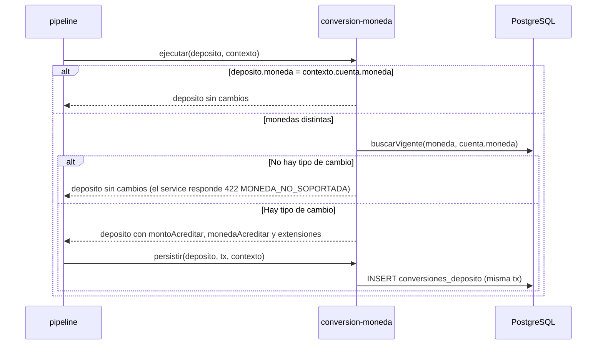

# SPEC-11 · conversion-moneda

## 1. Metadatos y Tech Stack

**Objetivo:** Si el depósito llega en una moneda distinta a la de la cuenta (PEN ↔ USD), calcular cuánto acreditar en la moneda de la cuenta según el tipo de cambio vigente.

- **Id:** `conversion-moneda` · **Tipo:** transformador · **Extiende:** SPEC-07 · **Orden:** en el manifest.
- **Depende de:** SPEC-06 (contrato: `ejecutar`, `persistir`, `leerExtension`).
- **Versión spec:** 1.1

**Stack:** pg 8.13, decimal.js 10.4. Pruebas: Jest 29 + Supertest 7 + nock 13.

## 2. Archivos Involucrados

El Agente tiene permitido leer y modificar ÚNICAMENTE los siguientes archivos:

- [NUEVO] `src/modules/conversion-moneda/index.js` (`{ id, tipo: 'transformador', ejecutar, persistir, leerExtension }`).
- [NUEVO] `src/modules/conversion-moneda/service.js` (`convertir(monto, valor)` con Decimal).
- [NUEVO] `src/modules/conversion-moneda/repository.js` (`buscarVigente(db, origen, destino)`, `insertar(tx, fila)`, `buscarPorDeposito(db, depositoId)`).
- [NUEVO] `db/11-conversion-moneda.sql`
- [NUEVO] `tests/unit/conversion-moneda/conversion.test.js` · `tests/integration/conversion-moneda/conversion.test.js`

## 3. Flujo del Sistema



## 4. Reglas de Negocio

- **CM-R01** · `deposito.moneda === contexto.cuenta.moneda` → devuelve `deposito` sin cambios.
- **CM-R02** · Si son distintas, usa la fila de `tipos_cambio` con `moneda_origen = deposito.moneda`, `moneda_destino = contexto.cuenta.moneda` y la `vigente_desde` más reciente que sea `<= now()`.
- **CM-R03** · Cada sentido tiene su propia fila: USD→PEN usa el tipo de compra del banco, PEN→USD el de venta.
- **CM-R04** · `montoAcreditar = monto × valor`, redondeado a 2 decimales con `Decimal.ROUND_HALF_UP`.
- **CM-R05** · Al convertir: `deposito.montoAcreditar`, `deposito.monedaAcreditar = cuenta.moneda`, `deposito.extensiones['conversion-moneda']` (§5) y `contexto.privado.tipoCambioId`.
- **CM-R06** · Sin tipo de cambio para el par → devuelve `deposito` sin cambios y no lanza.
- **CM-R07** · `persistir`: si `deposito.extensiones['conversion-moneda']` existe, inserta en `conversiones_deposito` con la `tx` recibida; si no, no hace nada.
- **CM-R08** · `leerExtension(depositoId)` → el objeto de §5 desde `conversiones_deposito`, o `null` si no hay fila.
- **CM-R09** · Si billetera falla después, la fila de conversión se queda: pertenece al depósito FALLIDO.
- **CM-R10** · Fuente de los tipos de cambio: [POR ACORDAR]. Por ahora, carga manual en la tabla.

```sql
CREATE TABLE tipos_cambio (
    id              UUID PRIMARY KEY,
    moneda_origen   CHAR(3)        NOT NULL CHECK (moneda_origen IN ('PEN','USD')),
    moneda_destino  CHAR(3)        NOT NULL CHECK (moneda_destino IN ('PEN','USD')),
    valor           NUMERIC(10,4)  NOT NULL CHECK (valor > 0),
    vigente_desde   TIMESTAMPTZ    NOT NULL
);
CREATE INDEX idx_tipos_cambio_par ON tipos_cambio (moneda_origen, moneda_destino, vigente_desde DESC);

CREATE TABLE conversiones_deposito (
    deposito_id     UUID PRIMARY KEY REFERENCES depositos(id),
    tipo_cambio_id  UUID           NOT NULL REFERENCES tipos_cambio(id),
    moneda_cuenta   CHAR(3)        NOT NULL,
    tipo_cambio     NUMERIC(10,4)  NOT NULL,
    monto_final     NUMERIC(15,2)  NOT NULL
);
-- Valores de EJEMPLO [POR ACORDAR], solo para probar a mano.
INSERT INTO tipos_cambio VALUES
  ('00000000-0000-0000-0000-000000000001','USD','PEN',3.7500,'2026-01-01T00:00:00Z'),
  ('00000000-0000-0000-0000-000000000002','PEN','USD',0.2600,'2026-01-01T00:00:00Z');
```

## 5. El Contrato (API Contract)

No agrega rutas. Agrega este bloque a las respuestas de `POST /api/v1/depositos` (SPEC-07) y `GET /api/v1/depositos/{id}` (SPEC-08), **solo si hubo conversión**:

```json
"extensiones": { "conversion-moneda": { "monedaCuenta": "PEN", "tipoCambio": "3.7500", "montoAcreditado": "375.00" } }
```

`tipoCambio` va como string con 4 decimales y `montoAcreditado` con 2. A billetera se le envía `montoAcreditar` en `monedaAcreditar` (ej. `"375.00"` PEN).

## 6. Instrucciones de Ejecución para el Agente

1. **`desarrolladorback`:** Crear el módulo cumpliendo el contrato de SPEC-06. No tocar `src/core/`.
2. **`desarrolladorfront`:** Si viene `extensiones.conversion-moneda`, mostrar en el comprobante y en el detalle: "Se acreditaron S/ 375.00 (tipo de cambio 3.7500)". No calcular la conversión en el front.
3. **`tester`:** Cada prueba carga sus propios tipos de cambio (`limpiar()` vacía `tipos_cambio`). Integración con `usr-cliente-1`, canal APP, cuenta `0011-0123-456789` (PEN); limites-por-canal inactiva.
   - **CM-T01** · `100.00` USD, tipo 3.7500 → billetera recibe `"375.00"` PEN; fila con `monto_final` 375.00; respuesta con la extensión.
   - **CM-T02** · `150.00` PEN → sin fila; sin clave en `extensiones`.
   - **CM-T03** · USD sin tipo cargado → 422 `MONEDA_NO_SOPORTADA`.
   - **CM-T04** · Tipos de ayer (3.70) y de hoy (3.75) → usa 3.75.
   - **CM-T05** · Solo un tipo con `vigente_desde` mañana → 422 `MONEDA_NO_SOPORTADA`.
   - **CM-T06** · `convertir("10.01", "3.7555")` → `"37.59"`. `convertir("1.00", "3.7550")` → `"3.76"`.
   - **CM-T07** · Feature `inactivo`, USD → 422 `MONEDA_NO_SOPORTADA`.
   - **CM-T08** · Billetera 500 después de convertir → depósito FALLIDO; la fila de conversión se queda.
4. **`revisor`:** Verificar CM-R04 (Decimal y redondeo) y CM-R07 (usa la `tx` recibida).

**Criterios de aceptación:**
- ✅ Un depósito en otra moneda se acredita convertido con el tipo de cambio vigente.
- ✅ La conversión queda registrada y se ve en el detalle del depósito.
- ✅ Sin la feature, un depósito en otra moneda se rechaza con 422.
