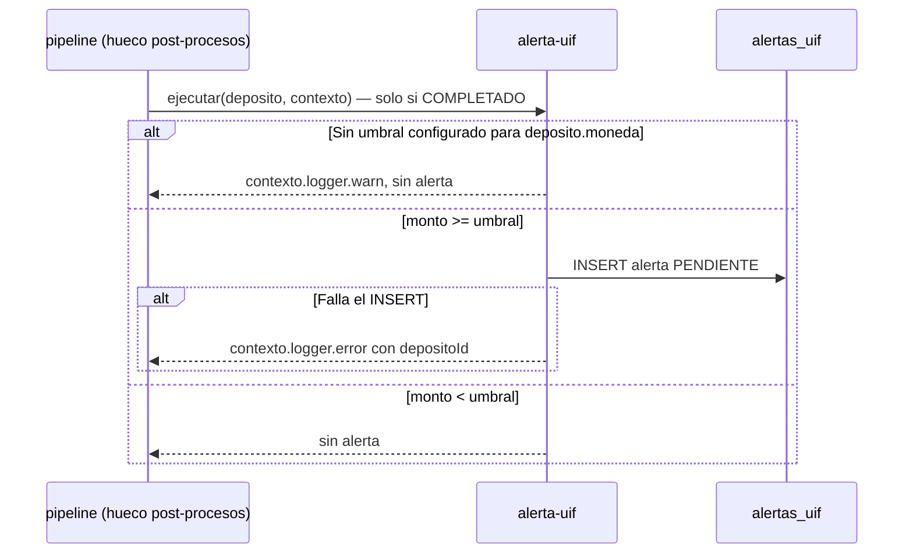

# SPEC-12 · alerta-uif

## 1. Metadatos y Tech Stack

**Objetivo:** Marcar los depósitos que igualan o superan el umbral de la normativa antilavado, para que el área de cumplimiento los revise y, si corresponde, los reporte a la UIF-Perú (SBS). Nunca bloquea el depósito.

- **Id:** `alerta-uif` · **Tipo:** post-proceso · **Extiende:** SPEC-07 · **Orden:** en el manifest.
- **Depende de:** SPEC-06 (contrato de extensión).
- **Versión spec:** 1.1

**Stack:** pg 8.13, decimal.js 10.4. Pruebas: Jest 29 + Supertest 7 + nock 13.

## 2. Archivos Involucrados

El Agente tiene permitido leer y modificar ÚNICAMENTE los siguientes archivos:

- [NUEVO] `src/modules/alerta-uif/index.js` (`{ id, tipo: 'post-proceso', ejecutar }`. Sin `leerExtension`).
- [NUEVO] `src/modules/alerta-uif/repository.js` (`insertar(db, alerta)`).
- [NUEVO] `db/12-alerta-uif.sql`
- [NUEVO] `tests/unit/alerta-uif/alerta.test.js` · `tests/integration/alerta-uif/alerta.test.js`
- [SOLO LEER] `src/config.js` (`UIF_UMBRAL_PEN`, `UIF_UMBRAL_USD`).

## 3. Flujo del Sistema



## 4. Reglas de Negocio

- **UIF-R01** · El pipeline solo lo llama cuando el depósito quedó COMPLETADO, también tras un reintento exitoso.
- **UIF-R02** · Compara `deposito.monto` en `deposito.moneda` (el monto **depositado**, no el convertido).
- **UIF-R03** · `monto >= umbral` (Decimal `gte`) → inserta en `alertas_uif` con `id = crypto.randomUUID()`, `estado_reporte` PENDIENTE y el umbral usado.
- **UIF-R04** · Umbrales en `UIF_UMBRAL_PEN` y `UIF_UMBRAL_USD`. **El valor real debe verificarse en la normativa SBS vigente** [POR ACORDAR]; nunca en el código. Si falta el de esa moneda → `logger.warn` y no hay alerta.
- **UIF-R05** · Nunca cambia el estado del depósito ni la respuesta. No tiene `leerExtension`: no se muestra a ningún rol.
- **UIF-R06** · Si el INSERT falla → `contexto.logger.error` con `depositoId` (para reprocesar) y no relanza.
- **UIF-R07** · `estado_reporte` puede cambiar después (PENDIENTE → REPORTADO o DESCARTADO); por eso no va en la auditoría, que es inmutable.
- **UIF-R08** · Fuera de alcance: detectar fraccionamiento (varios depósitos pequeños que suman el umbral) y la pantalla de cumplimiento.

```sql
CREATE TABLE alertas_uif (
    id              UUID PRIMARY KEY,
    deposito_id     UUID          NOT NULL UNIQUE REFERENCES depositos(id),
    monto           NUMERIC(15,2) NOT NULL,
    moneda          CHAR(3)       NOT NULL,
    umbral          NUMERIC(15,2) NOT NULL,
    estado_reporte  VARCHAR(20)   NOT NULL DEFAULT 'PENDIENTE'
                    CHECK (estado_reporte IN ('PENDIENTE','REPORTADO','DESCARTADO')),
    creado_en       TIMESTAMPTZ   NOT NULL DEFAULT now()
);
```

## 5. El Contrato (API Contract)

No agrega rutas ni cambia ninguna respuesta. Es invisible para el cliente.

## 6. Instrucciones de Ejecución para el Agente

1. **`desarrolladorback`:** Crear el módulo cumpliendo el contrato de SPEC-06. No tocar `src/core/`.
2. **`desarrolladorfront`:** No aplica.
3. **`tester`:** Usar `UIF_UMBRAL_PEN=1000.00` y `UIF_UMBRAL_USD=300.00`, nunca el valor real. Integración con `usr-cajero-1`, canal VENTANILLA (límite alto), cuenta `0011-0123-456789` (PEN); conversion-moneda inactiva.
   - **UIF-T01** · COMPLETADO con `1000.00` PEN → 1 fila PENDIENTE con umbral 1000.00.
   - **UIF-T02** · COMPLETADO con `999.99` PEN → 0 filas.
   - **UIF-T03** · Billetera 500, `5000.00` PEN (FALLIDO) → 0 filas.
   - **UIF-T04** · Forzar error en el INSERT → 201 normal; `logger.error` con `depositoId`.
   - **UIF-T05** · `GET /depositos/{id}` de un depósito con alerta → sin datos de UIF en la respuesta.
   - **UIF-T06** · Feature `inactivo`, `5000.00` PEN → 201; 0 filas.
   - **UIF-T07** · Sin `UIF_UMBRAL_PEN` (unitaria), `5000.00` PEN → 0 filas; `logger.warn`.
4. **`revisor`:** Verificar UIF-R03 ("mayor o igual" con Decimal), UIF-R04 y UIF-R05.

**Criterios de aceptación:**
- ✅ Todo depósito completado sobre el umbral genera una alerta.
- ✅ La alerta nunca afecta al depósito ni la ve el cliente.
